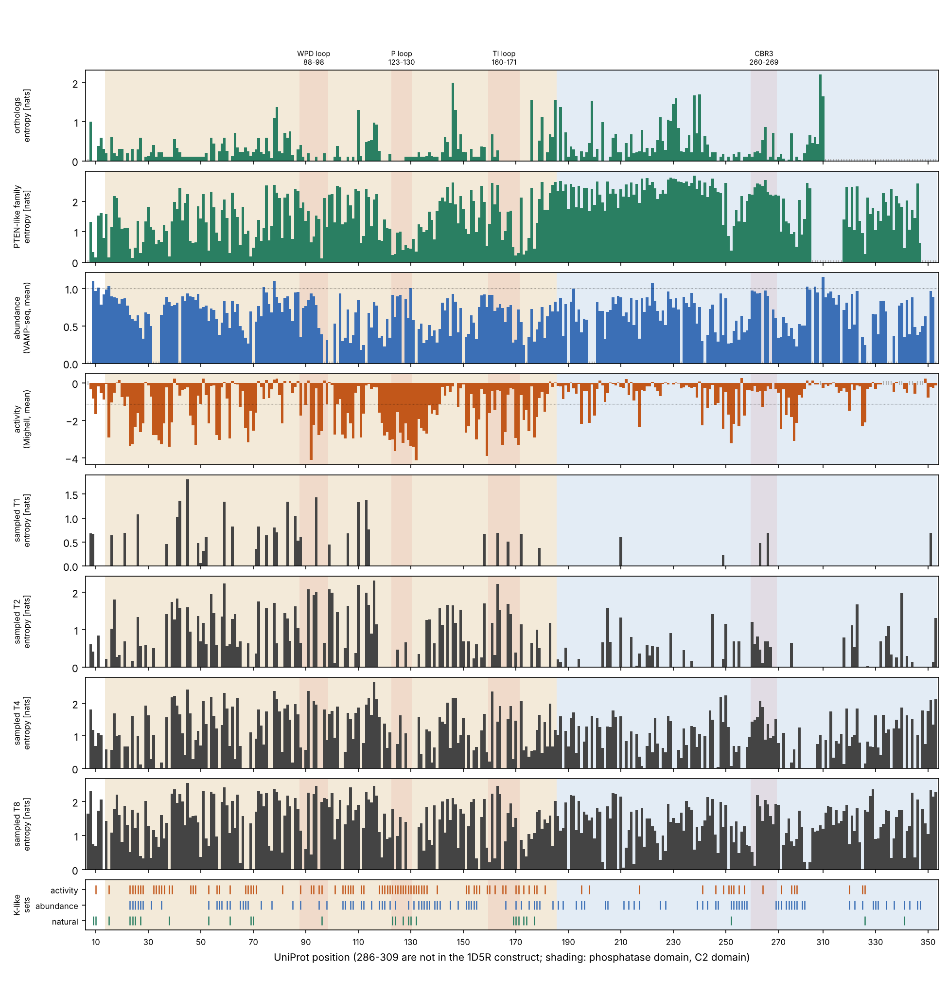
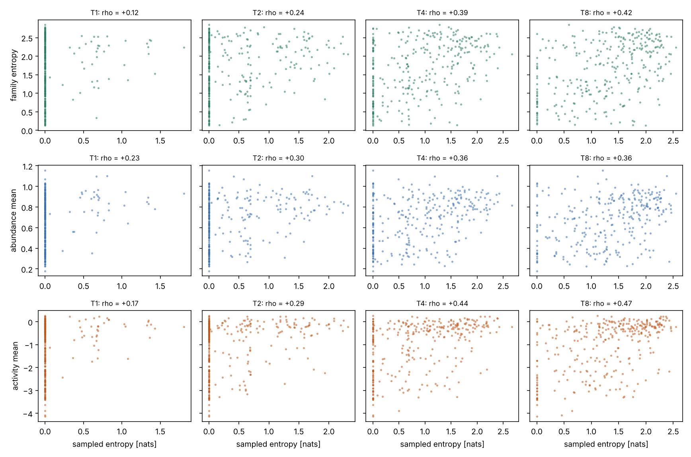
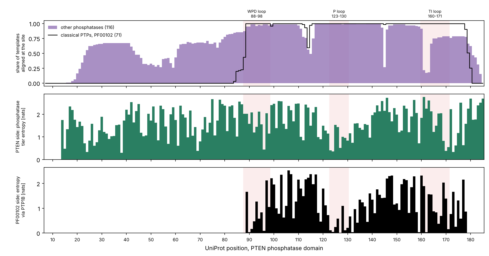
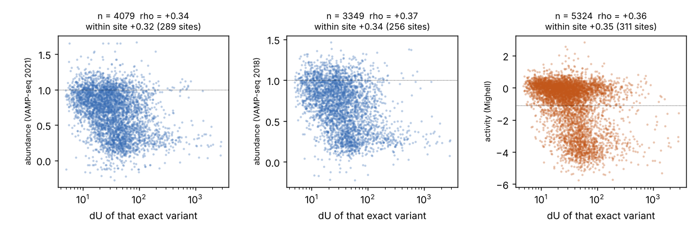
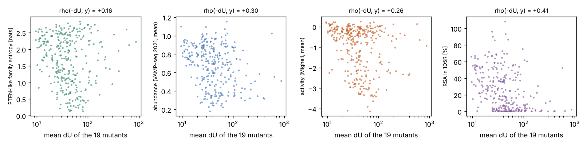
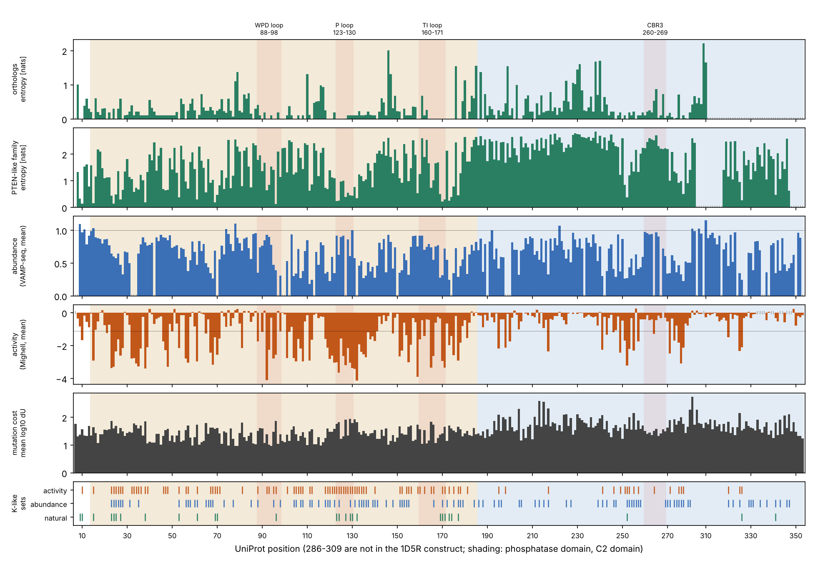

This is the long version of `pten_k_sites.md`. It explains what was compared, where every
number comes from, how to read each figure, and what to run on the GPU machine. Scripts:
`softmax/monte_carlo/pten_k_sites.py` and, for the in-silico mutant scan of section 6,
`softmax/monte_carlo/scan_single_mutants.py`. Outputs:
`softmax/monte_carlo/pten_natural/`.

# 1. The question

In Zambon et al. 2024 a **K-site** is a site that the sampler keeps completely conserved at
the lowest temperatures, and that stays strongly conserved everywhere below the structural
transition. For protein G there are seven. The paper then asks whether those sites are also
the ones that nature keeps conserved in the homologs of the protein. If they are, the
effective energy has captured something real about what the fold needs.

For PTEN we can ask the same question three times, because there are three independent ways
of knowing that a site "cannot change":

| reference | the question it answers | where it comes from |
| --- | --- | --- |
| natural | which sites does evolution keep fixed? | an alignment of natural homologs |
| abundance | which sites, when mutated, make the protein disappear from the cell? | VAMP-seq, Matreyek et al. 2018 |
| activity | which sites, when mutated, stop the enzyme from working? | Mighell et al. 2018 |

Each reference gives one number per site. The sampler gives one number per site too, the
entropy of the residue at that site along a chain. Everything in this document is a
comparison between those per-site profiles.

**The numbering.** The sampled reference `pten_1d5r` is the crystal construct, 324 residues:
UniProt residues 7 to 285 followed by 310 to 353. The loop 286 to 309 was deleted to get
crystals. Two of the 324 residues are not native: the first one (a Met where the protein has
Glu7) and the one at the deletion junction (a Val). They have no experimental score and are
left out of every comparison. In the tables `site` is the 0-based index used in `data.dat`,
and `uniprot_pos` is the numbering both papers use. The phosphatase domain is UniProt 14 to
185 (172 sites) and the C2 domain is 186 to 351 (144 sites).

## 1.1 The missing loop: should the sampler use the whole sequence?

**What is missing.** The crystal construct leaves out three pieces of the 403-residue
protein: residues 1 to 6, the loop 286 to 309 inside the C2 domain, and the tail 354 to 403.
All three are disordered: they have no fixed shape, which is why they were removed to obtain
crystals. The loop has no coordinates in any PTEN structure.

**What the references say about the loop.** They cover it, because both scans were done on
the full-length protein, and the full-length alignment exists (section 3.1).

| over the 24 loop sites | loop | the 322 construct sites |
| --- | --- | --- |
| abundance, mean score | 0.94 (277 variants) | 0.67 |
| activity, mean score | -0.02 (417 variants) | -1.01 |
| sites in the abundance K-like set | 0 | 108 |
| sites in the activity K-like set | 0 | 97 |
| ortholog entropy [nats] | 1.49 | 0.24 |

Every reference agrees: the loop is the freest part of the protein. Any residue can be put
there without changing abundance or activity, and it is the region that varies most between
species.

**What including it would buy.** Native numbering with no junction, 24 more sites, and a
length of 347 residues (7 to 353), or 353 from residue 1, which is at the 350 floor set when
the target was chosen.

**What it would cost.**

1. Every chain run so far is on the 324-residue construct. The energy is defined by the
   attention map of the reference sequence, so a new reference is a new landscape: the
   decode gate, the temperature ladder and the 220,000-move chains would all be redone.
2. The comparison would get easier, not better. The loop adds 24 sites where the right
   answer is "anything goes". If the sampler also leaves them free, every correlation rises,
   but for a trivial reason, and the hard question (which of the folded sites are
   protected) is no better answered.
3. The natural family alignment gets worse (section 3.1): the loop is specific to PTEN, the
   relatives do not have it, and their alignments break there.
4. The structure comparison cannot score the loop, since no crystal shows it.

**Recommendation.** Keep the construct as the sampled reference. Treat the loop as a
reference-only fact, as in the table above. If you want the loop tested, the cheap version
is a positive control and not a new study: one decode of the 347-residue sequence, then a
single short chain at T = 4 to see whether the loop sites become the most variable ones.
That is half a day of GPU and does not disturb the ladder. This is a choice about the thesis
design, so it is yours and your supervisors' to make.

# 2. The two papers

## 2.1 Matreyek et al. 2018: abundance (VAMP-seq)

*Multiplex assessment of protein variant abundance by massively parallel sequencing.*
Nature Genetics 50, 874-882 (2018). PubMed 29785012.

**The idea.** A missense mutation can break a protein in two different ways. It can leave the
protein folded but remove a residue the chemistry needs, or it can make the protein unable to
fold. An unfolded protein is recognised by the cell's quality control and degraded, so its
steady-state amount drops. Measuring how much of each variant is present in the cell is
therefore close to measuring whether it folds.

**The method.** VAMP-seq stands for variant abundance by massively parallel sequencing.

1. A library of PTEN variants is built in which each variant is fused to green fluorescent
   protein (GFP). If the PTEN part is degraded, the GFP goes with it, so the cell's green
   fluorescence reports the abundance of that variant.
2. The library is put into human cells (HEK 293T) so that every cell carries exactly one
   variant, integrated at the same genomic position. A red protein (mCherry) is expressed
   from the same construct as an internal control, so the read-out is the green to red ratio.
3. The cells are sorted by that ratio into four bins, from dim to bright.
4. The variants in each bin are identified by sequencing. A variant found mostly in the dim
   bins has low abundance; one found mostly in the bright bins has normal abundance.
5. The result is an **abundance score** per variant, scaled so that wild type is 1 and the
   median nonsense (truncated) variant is 0.

**What they measured.** 7,801 single amino acid variants across two proteins, PTEN and TPMT.
For PTEN, in the data files of the paper: 4,112 of the 7,639 possible missense variants have
a score (54%), from up to eight replicate experiments. The synonymous variants have a median
of 1.00 and the nonsense variants a median of 0.06, which is the check that the scale means
what it says.

**How a variant is classified.** The reference distribution is the synonymous variants,
which do not change the protein. Its 5th percentile is 0.71. A variant is "low" when its
score and the upper end of its confidence interval are both below that value, "possibly low"
when only the score is, and "wt-like" or "possibly wt-like" on the other side. Of the 4,112
scored PTEN missense variants: 1,138 low, 633 possibly low, 879 possibly wt-like, 1,462
wt-like. The 1,138 is the number quoted in the abstract.

**What they found.**

- About a quarter of the scored missense variants clearly reduce abundance. They concentrate
  at buried, hydrophobic positions and at residues whose side chains make hydrogen bonds or
  salt bridges inside the protein.
- A set of positions has mean abundance *above* wild type. They lie near the face of the
  protein that binds the membrane.
- Low-abundance PTEN variants are enriched among the variants seen in cancer and in PTEN
  hamartoma tumour syndrome, so loss of abundance is a common way for PTEN to fail.
- Not every pathogenic variant has low abundance. Active-site variants are present at normal
  levels and are simply inactive. One of them, p.Pro38Ser, common in melanoma, is stable and
  acts as a dominant negative.
- The method works on other proteins as well.

**What we use.** Two files from the paper's repository (`github.com/FowlerLab/VAMPseq`):
`PTEN_variant_data.tsv`, one row per variant, and `PTEN_positional_data.tsv`, one row per
position, which carries the authors' own call of 115 positions as mutationally "intolerant"
and 41 as "enhanced". In that table the intolerant positions have a mean score between 0.13
and 0.72. We also use the 2021 follow-up (Matreyek et al., Genome Medicine 13:165), which
filled in missing variants and brings PTEN to 5,083 scored missense variants. The scores are
the copyright of the University of Washington, free for academic non-commercial use, which is
why the raw files are downloaded by the script and not stored in the repository.

## 2.2 Mighell et al. 2018: lipid phosphatase activity

*A saturation mutagenesis approach to understanding PTEN lipid phosphatase activity and
genotype-phenotype relationships.* American Journal of Human Genetics 102, 943-955 (2018).
PMC5986715.

**The idea.** Measure, for every possible single substitution, whether PTEN can still do its
job: remove the 3-phosphate from the membrane lipid PIP3.

**The method.** The assay runs in yeast, which has no PIP3 signalling of its own.

1. The human PI3 kinase catalytic subunit (p110-alpha, anchored to the membrane) is expressed
   in yeast. It converts the yeast's essential PIP2 into PIP3. The loss of PIP2 is toxic and
   the yeast stops growing.
2. PTEN is expressed in the same cell. A working PTEN converts PIP3 back to PIP2 and growth
   returns. Wild-type PTEN rescues growth; the catalytically dead C124S does not; partially
   active variants give intermediate growth.
3. A library holding every amino acid substitution at every codon, plus a stop codon and a
   single-codon deletion, is grown as a pool. Variants that rescue growth become more
   frequent, variants that do not become rarer.
4. Sequencing before and after selection gives a **fitness score** per variant: the
   log-scaled enrichment relative to wild type. Wild type is 0. Nonsense variants have a
   median of -3.7 in the data file.
5. Two independent yeast populations, three selection replicates each. The two populations
   agree with a Pearson correlation of 0.76.

**What they measured.** Scores for 8,019 variants, 95% of those intended. 7,244 of them pass
the high-confidence filter (86%). That count includes stops and deletions; the
high-confidence *missense* variants, which are the ones we use, are 6,564.

**How a variant is classified.** Again against the synonymous variants. In the paper a
variant is wild-type-like when it falls inside the range of the synonymous variants (about
-1 and above) and truncation-like when it falls inside the range of the nonsense variants
(about -2.15 and below). Anything in between is a partial loss of function, a hypomorph.
Among the high-confidence variants 67% are wild-type-like, 31% are damaging and 1% are
better than wild type; 1,243 missense variants are truncation-like. The 2021 abundance paper
uses a single cut at -1.11 for "loss of activity", and that is the value our script uses.

**What they found.**

- The phosphatase domain is far less tolerant than the C2 domain. The catalytic pocket is
  the least tolerant region: C124 and R130 accept no substitution, H93, K125 and K128 very
  few, D92 only asparagine, G129 only alanine and serine.
- Positively charged residues that bind the membrane matter: the PIP2-binding motif at
  residues 6 to 15, and R47.
- Truncations are damaging anywhere in the two domains and tolerated in the C-terminal tail.
- Fitness correlates with evolutionary conservation (Spearman 0.58) and with burial: the
  intolerant positions are 91% buried, the tolerant ones 26%.
- About half of PTEN's positions tolerate most substitutions.
- Clinically, the scores separate known pathogenic variants from benign ones better than the
  computational predictors they tested. Variants found in autism and developmental delay are
  on average milder than those found in PTEN hamartoma tumour syndrome: 41% against 20% fall
  in the hypomorphic range.

**The catalytic pocket.** It is the cavity on the surface of the phosphatase domain where
the reaction happens: the phosphate group of the substrate enters it and is cut off there.
Its walls are three loops of the chain.

| loop | residues | role |
| --- | --- | --- |
| P loop | 123 to 130, sequence HCKAGKGR | the floor of the pocket. It is the signature motif of the whole enzyme superfamily, HCxxGxxR. C124 attacks the phosphate; R130 holds the phosphate in place; the backbone of the residues in between wraps around it |
| WPD loop | 88 to 98 | one wall. It carries D92, the acid that completes the reaction, and H93 |
| TI loop | 160 to 171 | the opposite wall. Named after T167 and I168; with Q171 it shapes the opening |

Two features set PTEN's pocket apart from those of the protein phosphatases it descends
from, and both follow from its substrate being the head group of a lipid, which is bigger
and more negatively charged than a phosphorylated amino acid. The pocket is wider and
deeper, and it is positively charged: H93 in the WPD loop and K125 and K128 in the P loop
point into it. In our data this is the region marked by the pink bands in Figure 1, and it
is where the natural K-like set concentrates.

**Which sequences stand behind "fitness correlates with conservation".** Not ours, and not
a 90% threshold. The paper takes the conservation values from **ConSurf-DB** with default
settings and says nothing more. ConSurf is a public server that, for a given protein,
collects homologs, aligns them, builds a phylogenetic tree and estimates how fast each site
evolves; it reports a grade from 1 (variable) to 9 (conserved). Three differences from our
tiers:

- *Its thresholds work the other way round.* By default ConSurf keeps homologs between a
  minimum identity to the query (35%) and removes sequences that are too similar to each
  other (above 95%), then takes a sample of at most a few hundred. So it deliberately
  reaches far from PTEN and discards near-duplicates. Our 90% rule does the opposite: it
  keeps only the near-duplicates. ConSurf's selection resembles our **family** tier
  (median identity to PTEN 0.33), not the vertebrate one. These default values are from my
  memory of the ConSurf documentation, and the paper does not restate them.
- *It measures rate, not entropy.* The grade accounts for the tree, so ten identical
  mammals do not count ten times. Our redundancy weighting is a cruder way to the same end.
- *It is a grade from 1 to 9*, so many sites are tied.

Their value is Spearman 0.58 between the per-site median fitness and the grade. Ours, with
the same activity data: +0.69 for the family tier and +0.51 for the orthologs tier. The
three numbers tell the same story.

**What the assay does not see.** Protein-protein interactions, localisation, regulation by
phosphorylation and dominant-negative effects in human cells. It does partly see stability,
because an unstable variant is also inactive.

**What we use.** The supplementary table of the paper as redistributed in
`github.com/MatreyekLab/PTEN_composite` (`Mighell_PTEN_phosphatase_data.csv`), columns
`Cum_score` and `High_conf`.

## 2.3 Why two scans and not one

Abundance and activity overlap but are not the same thing. A variant that does not fold has
low abundance and low activity. A variant that folds but lacks a catalytic residue has normal
abundance and low activity. The sampler's energy `U_am` is built from ESM3's attention map
and knows about structure only, so in principle it should agree with abundance. Activity is
the control: sites that matter for activity but not for abundance are sites the sampler has
no reason to protect.

# 3. The natural reference

## 3.1 Where the alignment comes from

The file is the UniRef90 alignment of the 1D5R chain from OpenProteinSet (the alignments
computed for training OpenFold, public on Amazon S3, licence CC BY 4.0). It was made with
jackhmmer, a program that searches a sequence database for relatives of a query, builds a
statistical profile from the hits and searches again with the profile. UniRef90 is UniProt
clustered so that no two entries are more than 90% identical. The query is exactly our
324-residue reference, so the alignment columns are our sites and nothing has to be
re-aligned. It holds 7,989 hits.

**And with the loop in the query?** OpenProteinSet also holds the alignment of a
full-length PTEN chain (PDB 7JVX chain A), made the same way, so this can be answered with
data in hand.

| | construct query (1D5R, no loop) | full-length query (7JVX) |
| --- | --- | --- |
| hits | 7,989 | 7,612 |
| hits covering the loop 286-309 | not applicable | 589 |
| hits covering 310-353 | 1,181 | 500 |
| vertebrate tier | 92 sequences, N_eff 22 | 75, N_eff 15 |
| orthologs tier | 123, N_eff 44 | 130, N_eff 66 |
| family tier | 2,716, N_eff 506 | 623, N_eff 186 |
| phosphatase tier | 6,002 | 5,986 |

(For the full-length query the tiers are computed over residues 7 to 353, loop included.
Reproduce with `python pten_k_sites.py loop`.)

So including the loop gives slightly fewer hits and a family tier four times smaller. The
reason is that the loop exists only in PTEN itself. Tensins, auxilin and the
voltage-sensing phosphatases do not have it, so with the loop in the query their alignment
breaks at residue 286 and most of them no longer cover 80% of the sequence. Only 589 hits,
essentially the PTEN orthologs, align across it. Within those the loop is by far the most
variable region: 1.49 nats in the orthologs tier against 0.24 for the rest.

The two queries agree where they overlap: the family entropy from the full-length alignment
and from the construct alignment correlate at 0.95 over the 305 shared sites. The
full-length alignment does one thing better: among orthologs it covers 310 to 353 almost
completely (7% gaps), where the construct alignment is truncated.

Most hits are not PTEN. The PTEN-like family includes TPTE and the voltage-sensing
phosphatases, the tensins, and auxilin and GAK. All of them share the phosphatase domain and
the C2 domain, in that order. Further out are proteins that only share the phosphatase
domain.

## 3.2 The four tiers

The same alignment is cut at four depths. "Identity" is the fraction of aligned residues
equal to PTEN's. "Coverage" is the fraction of the 324 reference columns the hit covers.

| tier | rule | sequences | N_eff | median identity to PTEN | sites with an entropy |
| --- | --- | --- | --- | --- | --- |
| vertebrate | identity >= 0.90, coverage >= 0.8 | 92 | 22 | 0.96 | 280 |
| orthologs | identity >= 0.70, coverage >= 0.8 | 123 | 44 | 0.94 | 280 |
| family | coverage >= 0.8 (both domains present) | 2,716 | 506 | 0.33 | 305 |
| pdomain | covers >= 0.7 of the phosphatase domain | 6,002 | 1,125 | 0.34 | 172 |

**N_eff, the effective number of sequences.** Databases over-represent some groups (many
mammals, few of anything else). To stop a crowd of near-identical sequences from dominating,
each sequence is given the weight 1 / (number of sequences at least X% identical to it,
itself included). N_eff is the sum of the weights. X is 80% for the family and pdomain
tiers, the usual choice in the coevolution literature, and 95% for the two ortholog tiers,
because at 80% nearly all orthologs would fall in one cluster and N_eff would be about 1.

**Entropy.** For each site, the Shannon entropy of the weighted amino acid frequencies, in
nats: 0 when one residue is always there, ln 20 = 3.0 when all twenty are equally likely.

**Sites without an entropy.** A site gets no value when more than half of the weighted
sequences have a gap there. This happens at the C-terminal end. Natural PTEN has the 286 to
309 loop that the construct lacks, so many alignments stop at the deletion and never reach
310 to 353.

The thresholds are options of the script; section 8 shows how to change or remove them.

## 3.3 The flatness table, with the amount of data behind each row

| profile | data behind it | sites | mean | median | 10th to 90th percentile |
| --- | --- | --- | --- | --- | --- |
| vertebrate entropy [nats] | 92 sequences, N_eff 22 | 280 | 0.17 | 0.01 | 0.00 to 0.55 |
| orthologs entropy [nats] | 123 sequences, N_eff 44 | 280 | 0.31 | 0.19 | 0.00 to 0.73 |
| family entropy [nats] | 2,716 sequences, N_eff 506 | 305 | 1.66 | 1.76 | 0.56 to 2.57 |
| pdomain entropy [nats] | 6,002 sequences, N_eff 1,125 | 172 | 1.64 | 1.63 | 0.72 to 2.46 |
| abundance 2018, mean score | 3,349 variants on these sites | 256 | 0.68 | 0.71 | 0.34 to 0.95 |
| abundance 2018+2021, mean score | 4,079 variants on these sites | 289 | 0.67 | 0.71 | 0.34 to 0.94 |
| activity, mean score | 5,324 variants on these sites | 311 | -1.01 | -0.48 | -2.79 to 0.02 |

The variant counts are lower than the totals in section 2 because they count only the 322
native sites of the construct, not all 403 residues of PTEN. A site needs at least 5 scored
variants to get a mean; the median site has 14 for abundance and 18 for activity.

**Reading.** The vertebrate profile is flat: 176 of 280 sites are below 0.05 nats. The
ortholog profile is nearly flat. So an ortholog alignment cannot tell sites apart, as you
expected. But note how little data that conclusion rests on: 92 sequences worth 22
independent ones. A site with entropy 0 there may simply not have had time to change.
The family tier, the abundance scan and the activity scan are not flat at all, and they are
the three profiles the sampler is compared with.

# 4. The three K-like sets

Sections 3 and 5 compare whole profiles, one number per site, with rank correlations. A
*set* comparison asks a blunter question, the one Zambon's paper asks: is this site on the
list of sites that cannot change, yes or no? For that, each reference needs a rule that
turns its profile into a list. A rule is a choice, so each one is explained here together
with the option that changes it and what happens when you do.

## 4.1 The rules

**Natural set: the family entropy is below 0.5 nats.**
The entropy of a site measures how many different amino acids the family uses there. A
value of 0.5 nats corresponds to one amino acid present in about 90% of the weighted
sequences and the rest scattered. In the 28 sites of the set, the dominant residue has a
frequency between 0.89 and 0.98. The paper's own K-site rule for the *sampler* is much
stricter (entropy essentially 0), but no site of a 2,716-sequence family alignment spanning
PTEN, tensins and auxilin reaches 0, so a looser cut is needed on the natural side. The
tier used is the family tier because the ortholog tiers are too flat to rank sites and the
phosphatase tier covers only one domain.

**Abundance set: the positions the authors themselves call "intolerant".**
`PTEN_positional_data.tsv` from the 2018 paper carries a label per position: 115 are
"intolerant" in the whole protein, 108 of them on our sites. Using the authors' list means
the set is not tuned by us. I could not read the paper's exact definition, so I
reconstructed it from the data: the label is given only to positions with at least 5 scored
variants, and it agrees at 98% with the rule "at least 58% of the position's scored variants
are low or possibly low", that is, have a score below the 5th percentile of the synonymous
variants (0.71). On our sites that rule gives 105 sites, of which 103 are in the authors'
list. So in plain words: a site is in the abundance set when most substitutions there make
the protein disappear.

**Activity set: at least half of the scored variants are below -1.11.**
The paper gives no list of intolerant positions, so the rule is ours, built to mirror the
abundance one. -1.11 is the score below which a variant counts as having lost activity in
the 2021 paper that combines the two scans. Mighell's own paper uses two cuts: about -1 for
"no longer wild-type-like" and about -2.15 for "as bad as a truncation". "At least half"
means the typical substitution at that site kills the enzyme.

**A site needs at least 5 scored variants** to enter the abundance or activity set, because
a fraction over two or three variants means little.

## 4.2 The sets with the default rules

| set | sites | in the phosphatase domain | in the C2 domain |
| --- | --- | --- | --- |
| natural | 28 | 23 | 3 |
| abundance | 108 | 61 | 47 |
| activity | 97 | 77 | 19 |

The natural set contains the catalytic residues H123, C124, G127, G129, R130 and G132, then
D24, P38 and P96, the TI loop (P169, S170, Q171, R173, Y174, Y177) and D252 in the C2 domain.

**Overlaps.** With 324 sites, two unrelated sets of sizes a and b share a x b / 324 sites on
average. P is the probability of an overlap at least as large as the observed one if the two
sets were unrelated (hypergeometric test).

| pair | observed | expected by chance | P |
| --- | --- | --- | --- |
| natural and activity | 24 | 8.4 | 2e-10 |
| abundance and activity | 56 | 32.3 | 2e-9 |
| natural and abundance | 12 | 9.3 | 0.18 |

Eleven sites are in all three sets: L23, D24, L25, Y27, V53, H61, C124, G129, S170, Y177, D252.

## 4.3 The options that change the rules

| option | default | what it changes |
| --- | --- | --- |
| `--natural-k` | 0.5 | the entropy cut of the natural set, in nats |
| `--natural-tier` | family | which tier's entropy is used: vertebrate, orthologs, family or pdomain |
| `--abundance-k` | not set | if given (for example 0.58), replaces the authors' list with our rule: share of a site's variants that are low or possibly low |
| `--activity-k` | 0.5 | the share of a site's variants that must be below the activity cut |
| `--activity-lof` | -1.11 | the activity cut itself |
| `--min-variants` | 5 | scored variants a site needs |

They work with `build`, `compare`, `family` and `pfam`. The rule in force is printed in the
log next to each set. Examples:

    python pten_k_sites.py build --natural-k 1.0
    python pten_k_sites.py build --abundance-k 0.58 --activity-lof -2.15
    python pten_k_sites.py compare --runs-dir pten1d5r_study/equil --cold T1 T2 \
        --natural-k 1.0 --out-dir pten_natural/natural_k1

## 4.4 How much the conclusions depend on the rules

Measured by running `build` with one rule changed at a time.

| rule changed | set size | natural and abundance | natural and activity | abundance and activity |
| --- | --- | --- | --- | --- |
| defaults | 28 / 108 / 97 | 12 vs 9.3, P 0.18 | 24 vs 8.4, P 2e-10 | 56 vs 32.3, P 2e-9 |
| `--natural-k 0.3` | natural 13 | 4 vs 4.3, P 0.68 | 13 vs 3.9, P 9e-8 | unchanged |
| `--natural-k 1.0` | natural 69 | **37 vs 23.0, P 7e-5** | 57 vs 20.7, P 2e-25 | unchanged |
| `--natural-tier pdomain` | natural 9 | 3 vs 3.0, P 0.63 | 9 vs 2.7, P 2e-5 | unchanged |
| `--natural-tier orthologs --natural-k 0.05` | natural 69 | 36 vs 23.0, P 2e-4 | 38 vs 20.7, P 7e-7 | unchanged |
| `--abundance-k 0.58` | abundance 105 | 12 vs 9.1, P 0.15 | unchanged | 56 vs 31.4, P 4e-10 |
| `--abundance-k 0.5` | abundance 126 | 13 vs 10.9, P 0.25 | unchanged | 59 vs 37.7, P 1e-7 |
| `--activity-lof -2.15` | activity 73 | unchanged | 21 vs 6.3, P 7e-10 | 46 vs 24.3, P 3e-9 |
| `--activity-lof -1` | activity 100 | unchanged | 24 vs 8.6, P 4e-10 | 58 vs 33.3, P 6e-10 |
| `--activity-k 0.75` | activity 49 | unchanged | 19 vs 4.2, P 2e-11 | 28 vs 16.3, P 2e-4 |

**Reading.** Two conclusions are robust: natural conservation and activity always overlap
strongly, and so do abundance and activity. The third, "natural conservation and abundance
overlap no better than chance", **depends on the cut**. It holds for the tightest natural
sets (13 or 28 sites, or the 9 of the phosphatase tier), which are dominated by the
catalytic pocket. With a looser cut (69 sites) the overlap with abundance becomes clear,
37 against 23 expected. So the accurate statement is this: the *most* conserved sites of
the family are catalytic and say nothing about the fold; the *moderately* conserved ones do
include the sites the fold needs. The examples still stand (R15, H123 and R130 are among
the most conserved residues and have abundance 0.92 to 1.03), and it is consistent with the
profile correlation of section 3, which never depended on a cut: family entropy against
abundance has a Spearman of +0.41.

For the comparison with the sampler this argues for relying on the rank correlations of
section 5.2, and for quoting set overlaps together with the rule that produced them.

# 5. The sampler against the references

## 5.1 How the sampled entropy is computed

A chain is a sequence that changes one residue at a time. `data.dat` records every proposed
move and whether it was accepted, and `start.txt` the starting sequence. Replaying the
accepted moves reconstructs the sequence at every step. For each site the script counts how
many steps it spent on each amino acid, over the second half of the chain (the first half is
discarded as burn-in), and takes the Shannon entropy of those frequencies. A site that never
changed has entropy 0. The reconstruction is checked: the Hamming distance to the reference
at the end matches the `Hd_to_ref` column of `data.dat`.

Two other per-site quantities come out of the same replay:

- `native_frac`, the share of the time the site holds the reference residue;
- `mean_dU`, the average energy change of the moves *proposed* at the site, accepted or
  not. It is the sampler's own estimate of what mutating that site costs, and it needs no
  equilibration.

## 5.2 The numbers

Chains started from the reference, 220,000 moves at T = 1, 2, 4, 8 (run of 2026-11-13).
Spearman rank correlation between the sampled entropy and each reference: +1 means the two
rank the sites identically, 0 means no relation. With about 300 sites, values beyond 0.12
are outside chance at the 5% level. All references are oriented so that higher means more
tolerant, so a positive correlation is agreement.

| T | sites at entropy 0 | family | abundance | activity | family, burial removed | abundance, burial removed | activity, burial removed |
| --- | --- | --- | --- | --- | --- | --- | --- |
| 1 | 220 | +0.15 | +0.19 | +0.19 | +0.01 | +0.11 | +0.07 |
| 2 | 100 | +0.37 | +0.31 | +0.38 | +0.15 | +0.09 | +0.19 |
| 4 | 25 | +0.52 | +0.41 | +0.53 | +0.31 | +0.15 | +0.32 |
| 8 | 9 | +0.61 | +0.46 | +0.61 | +0.45 | +0.19 | +0.41 |

Mean sampled entropy inside each K-like set divided by the mean outside it:

| T | natural | abundance | activity |
| --- | --- | --- | --- |
| 1 | 0.23 | 0.34 | 0.46 |
| 2 | 0.29 | 0.45 | 0.39 |
| 4 | 0.41 | 0.63 | 0.53 |
| 8 | 0.51 | 0.76 | 0.64 |

A ratio of 1 would be the flat case: the sampler varying those sites as much as any other.
Every ratio is well below 1.

**The significance test.** Neighbouring sites resemble each other (a buried strand, an
exposed loop), so shuffling sites at random would exaggerate the significance. Instead the
whole set is shifted along the sequence by 1, 2, ..., 323 positions, which keeps its pattern
of runs, and the observed difference is ranked among the 323 shifted ones. The smallest p
this can give is 1/324 = 0.003, and that is the value reached at T >= 2 for almost every set.

**The sampler's own K-sites.** With the strict definition (entropy below 0.05 at both T = 1
and T = 2) there are 104. They contain 16 of the 28 natural sites (9.0 expected), 43 of the
108 abundance sites (34.7 expected) and 46 of the 97 activity sites (31.1 expected).

## 5.3 The burial control

### What RSA is

**Relative solvent accessibility.** Take a residue in the folded structure and measure the
area of its surface that a water-sized sphere can still touch — its solvent-accessible
surface area. On its own that number means little, because a tryptophan is bigger than a
glycine, so it is divided by the area the *same* residue type would expose with nothing
packed around it (the standard reference is that residue in an extended Gly-X-Gly
tripeptide). The ratio is the relative solvent accessibility, and it is comparable across
residue types: **0 means completely buried in the core, 100% means as exposed as it could
possibly be.** Values slightly above 100 occur for very exposed residues in unusual
backbone conformations, which is why ours reach 108.

Ours is the `rsa` column of the VAMP-seq positional table, computed by Matreyek et al. on
the 1D5R crystal. It exists for the 277 of our 324 sites that are resolved in that crystal.
Median 18.7%, with 85 sites under 5% (genuinely core) and 56 above 50% (surface).

### Why it has to be controlled for

Burial drives everything at once. A buried side chain is packed against its neighbours, so
almost any substitution disturbs the packing and destabilises the protein; and evolution
conserves those positions for the same reason. Measured on our table:

| | buried (RSA < 10%, 103 sites) | exposed (RSA > 40%, 77 sites) |
| --- | --- | --- |
| mean `log10 dU` | 1.70 | 1.40 |
| mean abundance score | 0.50 | 0.83 |
| mean family entropy | 1.17 | 2.05 |

Every column separates. So burial is a **common cause**: it independently raises the
energy's cost, lowers the experimental abundance and lowers the natural entropy. Two
quantities that both track burial will correlate with each other even if neither knows
anything else. And that is the whole worry, because RSA can be computed from the crystal
structure in milliseconds with no model at all — if the energy's agreement with the
experiments were to vanish once burial is removed, then 6,156 ESM3 forward passes would be
an expensive way of rediscovering which residues are in the core.

### The "RSA itself" row, and what regressing it out does

The row labelled **RSA itself** is the plain Spearman of each quantity with RSA: how much
each one is simply measuring burial. On the site table:

| quantity | Spearman with RSA |
| --- | --- |
| abundance (VAMP-seq 2021) | +0.65 |
| activity (Mighell) | +0.64 |
| family entropy | +0.53 |
| orthologs entropy | +0.40 |
| `−mean log10 dU` (section 6) | **+0.43** |
| sampled entropy, T = 4 and 8 | +0.54 to +0.58 |

Read the fifth row against the ones above it: the energy agrees with burial (+0.43) *more
strongly than it agrees with any of the three biological references* (+0.31 for abundance is
its best). That is the fact that makes the control necessary rather than decorative.

**Regressing it out** means taking a partial correlation. Concretely, in
`partial_spearman`: rank all three quantities; fit a straight line predicting rank(x) from
rank(RSA) and keep the residual, i.e. the part of x's ordering that burial does not account
for; do the same for y; then correlate the two residuals. In words, it answers *among sites
that are equally buried, do the two still agree?* What survives is agreement burial cannot
explain.

One honest caveat on the direction of the error. Partialling out RSA removes everything that
burial can account for, including any genuine signal that happens to travel with burial —
and some of what the energy legitimately knows about packing *is* burial. So the partial
correlations are a deliberately conservative floor, not an unbiased estimate: the truth lies
somewhere between the raw and the partial column.

A related point worth noticing, because it is the quiet strength of section 6.3's
within-site statistic: **RSA is a property of a position, so it is constant within a site.**
It therefore cannot contribute anything to a within-site ranking, and the within-site
correlation needs no burial control at all — it has already conditioned on burial
completely, along with every other per-site property, measured or not.

### At T = 8

What remains after burial is removed is +0.45 for the family entropy, +0.41 for activity
and +0.19 for abundance.

**Reading.** The sampler is not flat, and the signal grows with longer chains. But once
burial is set aside it follows what the family conserves more than what keeps the protein
abundant. That is unexpected, because the energy contains no catalysis. Two explanations
are worth discussing with the supervisors. ESM3 was trained on natural sequences, so its
attention map may encode family conservation directly, function included. Or the active
site of PTEN is unusually well packed and RSA does not capture that. The single-mutant scan
of `U_am` (section 6) is the experiment that separates them. It has now been run, and 6.4b
has the answer: the energy on its own does **not** prefer family conservation — with burial
removed it keeps +0.12 with abundance and goes slightly negative on both natural tiers. So
the preference measured here comes from the sampling, not from the energy.

## 5.4 The figures

**Figure 1, `pten_site_profile_sampled.png`: everything along the sequence.**

The horizontal axis is the sequence, labelled in UniProt numbering; one bar per site. The
beige background is the phosphatase domain, the blue one the C2 domain. The four pink bands
are landmarks: the WPD loop (88 to 98), the P loop that holds the catalytic cysteine (123 to
130), the TI loop (160 to 171) and the CBR3 loop of the C2 domain that touches the membrane
(260 to 269).

- Rows 1 and 2, green: natural entropy, orthologs and family. Tall bar = variable site.
  A grey tick on the baseline means no value at that site.
- Row 3, blue: mean abundance score. The dotted line at 1 is wild type. A short bar is a
  site where mutations make the protein disappear.
- Row 4, orange: mean activity score, plotted downwards from 0. The dotted line is -1.11.
  A long bar is a site where mutations kill the enzyme.
- The grey rows: sampled entropy, one row per chain.
- Bottom row: the three K-like sets as tick marks.

What to look for: the P loop is a trough in the family entropy and a deep spike in activity,
yet abundance there is close to 1. In the sampled rows, the troughs line up with the regions
where the references are low, and they fill in as T rises.

**Figure 2, `sampled_vs_references.png`: site by site.**

Each dot is one site. Horizontal: its sampled entropy. Vertical: the reference (family
entropy, abundance, activity, from top to bottom). One column per chain, with the Spearman
correlation in the title. A cloud rising to the right is agreement. The vertical stripe of
dots at 0 on the left is the set of sites the chain never changed, which is why cold chains
look weak. The new version of the script writes one file per reference with a panel for
every chain: `sampled_vs_family.png`, `sampled_vs_abundance.png`, `sampled_vs_activity.png`.

**Figure 3, `sampled_vs_references_by_T.png` (new, produced by your run).** The Spearman
correlations of section 5.2 against temperature, for the chains started from the reference.
Solid lines are the raw correlations, dashed lines the ones with burial removed, one colour
per reference. Dots are single chains, lines the mean of the chains at that temperature.

**Figure 4, `pten_ptp_superfamily.png`: how far other phosphatases align.**

Only the phosphatase domain is shown. Top panel: for each PTEN site, the share of other
phosphatase structures whose profile alignment reaches it. The black line is the classical
protein tyrosine phosphatases (Pfam PF00102), the purple area all other related
phosphatases. The black line is zero until residue 85: classical PTPs align only to the
second half of the domain. Middle panel: PTEN's own conservation (the pdomain tier). Bottom
panel: the conservation of the classical PTP family, carried onto the PTEN sites it reaches.
The two agree at the P loop and little elsewhere.

# 6. The in-silico single-mutant scan

Everything in section 5 compares a *sampled* quantity with the references, and inherits the
sampling's problems: chains that are not equilibrated, one chain's time average, a burn-in
to choose. This section removes the sampler entirely. It evaluates the energy itself on
every single mutant of the reference, which is exactly what the two papers did in the
laboratory, and so gives the comparison that needs no equilibration at all.

## 6.1 Why `dU` is just `U`, and why it is a cost

The energy the project samples is

    U(s) = lambda_am * sum over i<j of [ log A_ij(s) - log A_ij(ref) ]^2

with `lambda_am = 1` and `lambda_structure_ce = 0` in every PTEN run, where `A` is ESM3's
symmetrised attention map. That is a squared distance in log space, so two things hold for
free:

- `U(s) >= 0` for every sequence `s`;
- `U(ref) = 0`, and the reference is therefore the global minimum.

Hence for a mutant of the reference the energy difference is the energy itself:

    dU = U(mutant) - U(ref) = U(mutant) >= 0

No subtraction, no reference chain, no equilibration. One forward pass per mutant gives a
number that is both the mutant's energy and its cost relative to PTEN. **Small `dU` means
the model finds the substitution cheap** — tolerant — and large `dU` means expensive. The
sign is therefore the opposite of the experimental scores, where a *high* VAMP-seq score
means the protein is still abundant. Every correlation below is taken with `-dU`, so that a
positive number means agreement, like everywhere else in this document.

## 6.2 What the scan script does

`scan_single_mutants.py` loads ESM3 once, computes the reference attention map once, then
walks the 324 sites. At each site it builds the 19 sequences that differ from the reference
only there, and computes `U` for them. The candidate residues are not hard-coded: they come
from the sampler's own `_competition_indices`, the same rule a move uses, so the scan covers
exactly the substitutions the sampler could ever propose and no others (the non-canonical
codes `X, B, U, Z, O` are structurally absent from it). 324 x 19 = **6,156 forward passes**.

Four things are worth knowing before you launch it.

1. **It is resumable.** The CSV is appended and flushed after every site, and re-running the
   same command skips the sites that are already complete in it (19 rows). A site that was
   interrupted half-way is redone from scratch, so there are never duplicate rows. Kill it
   and restart it freely.
2. **Do not batch it.** `--batch` defaults to 1, which calls the sampler's own
   `_exact_energy` one sequence at a time. Above 1 the script uses the batched forward from
   `code/tests/bench_batch.py`, which expands ESM3's batch-1 inputs by hand and keeps the
   same bfloat16 autocast — and that path was *measured* to disagree with `_exact_energy`,
   see 6.2a and 6.2b below. The whole scan takes about ten minutes either way, so there is nothing to
   buy by batching.
3. **It prints its own resolution limit.** Two forward passes on the *same* sequence should
   give exactly 0. Whatever they give instead is run-to-run numerical noise in the
   bfloat16 attention, and it is the floor below which no `dU` means anything. On astaroth
   it is exactly 0: the single-sequence forward is bit-reproducible. `--check` additionally
   recomputes the first site with `_exact_energy` and prints the largest disagreement with
   the batched path, with a verdict; it is forced on whenever `--batch > 1`.
4. **It refuses to disagree with the reference.** `pten_k_sites.py mutants` checks that the
   wild-type residue the scan mutated is the one in the site table, site by site, and stops
   if any differs: a CSV produced on another sequence is useless here.

## 6.2a What batching is, and where the discrepancy comes from

**Batching.** A forward pass sends one sequence through the network and gets one attention map
back. The GPU does that with thousands of threads, and at 324 residues there is not enough
work to keep them busy: the benchmark of 29 October measured the card about 41% idle during a
single-sequence pass. Batching stacks `B` sequences into one tensor and runs them through
together, so every matrix multiplication is `B` times bigger and the card is used properly.
The sequences never interact — it is `B` independent calculations sharing one trip through the
network. `--batch 19` means one site's 19 mutants per pass.

**It is mathematically a no-op here, and that was checked.** ESM3's own `_last_attention`
refuses a batch (`"Attention can be computed only for single sequences"`), so the batched path
in `code/tests/bench_batch.py` builds it by hand: it takes the same default tokens, expands
them from 1 row to `B` identical rows, and calls the encoder and the transformer stack
directly. The only post-processing, `clean_and_symm`, slices off the BOS and EOS positions and
averages the map with its transpose — per sequence, with nothing summed or normalised across
the batch. So no sequence can influence another, and the discrepancy is not the model seeing
them differently. It is arithmetic.

**Where the arithmetic goes.** Three things compound.

1. *The forward pass runs in bfloat16.* Under `torch.autocast` the matrix multiplications use
   bfloat16, which keeps 8 bits of mantissa against float32's 24 — its steps are 65,536 times
   coarser, a relative precision of about 0.39%. That is the error on every intermediate
   quantity, before anything accumulates.
2. *Floating-point addition is not associative, and the order depends on the shape.* `(a+b)+c`
   and `a+(b+c)` differ once rounding is involved. A GPU matrix multiplication computes each
   output entry as a sum of many products, split across threads and tiles and added back in an
   order the library chooses — and it chooses from the *shape* of the operands. Going from one
   sequence to nineteen changes every shape, so a different kernel runs, the partial sums are
   added in a different order, and the rounding lands differently. This is the step worth
   taking slowly, because it explains what looks like a contradiction in 6.2b: the same
   sequence run twice at the same batch size agrees **bit for bit** (noise floor 0), while the
   same sequence at two different batch sizes does not. Determinism in floating point is per
   shape, not absolute.
   In float32, summing the same 2,000 numbers forwards and then backwards already differs in
   the seventh digit. Here it is bfloat16, 65,536 times coarser, through 48 transformer blocks.
3. *`U_am` amplifies what is left.* The attention entries are small — a row of 326 positions
   sums to 1, so a typical entry is about 0.003 — and the energy takes their logarithm.
   Logarithms pass relative error straight through (`d log x = dx/x`), so bfloat16's 0.39% on
   an entry becomes about 0.0039 in absolute terms on `log am`. Then 52,326 pairs (the upper
   triangle of 324 × 324) are squared and summed. If those small errors point in random
   directions they largely cancel, which is the median difference of 0.55 measured in 6.2b; if
   they line up they do not, which is the maximum of 151.

**Why it had never mattered.** All of the above is equally true of every run this project has
done. It only became visible here because `dU = U` near the reference, so the quantity being
compared is 6 to 84 rather than the thousands that `U` reaches for a drifted sequence — see the
note on `bench_batch.py`'s tolerance at the end of 6.2b.

## 6.2b Measured on astaroth, 15 November: the batched path is biased

The first `--check` run on the card gave this, and it is worth keeping in the document because
it changed the default:

| quantity | value |
| --- | --- |
| `U_am(ref, ref)` | 0 |
| noise floor, two forward passes on the same sequence | 0 |
| max \|batched − `_exact_energy`\| at site 0 | 3.09 |
| the 19 mutants at site 0 | 24.5 to 84.5 |
| time | 0.032 s per mutant |

The first two lines are the good news, and they are stronger than expected: the
single-sequence forward is **bit-reproducible**, so `U_am` has no run-to-run noise at all
and there is no resolution limit to worry about. Every `dU` is a number that can be compared
with any other.

The third line is the problem. The batched forward is also deterministic, so a disagreement
of 3.09 is not noise — it is a *bias*, a different reduction order in bfloat16 amplified by
the logarithm (relative error passes straight through `d log x = dx/x`) and by the roughly
53,000 pairs that get summed. Three energy units is 12% of the cheapest mutant at that site,
and the cheapest mutant at site 1 is 6.1, so the bias is of the same order as the quantity.
It is also larger than the gaps between neighbouring mutants at a site, which means it can
**reorder them** — and the within-site correlation of section 6.3 is precisely a measurement
of that ordering. A batched scan would have put a number on it that was partly an artefact of
the kernel.

Hence `--batch 1`, the exact path, for anything that goes next to the experiments. It costs
nothing: 6,156 mutants at the measured rate is about ten minutes. Batching is still there for
a quick survey, and a batched run now always checks itself at its first site and prints an
explicit verdict rather than leaving the comparison to the reader.

**What the bias actually cost, measured.** Both scans exist, so the two can be compared
mutant by mutant. The batched run against the exact one, over all 6,156:

| | |
| --- | --- |
| median difference | 0.55 (1.6% of the value) |
| largest difference | 151 (22% of the value) |
| mutants differing by more than one energy unit | 26.5% |
| mutants whose rank *within their site* changed | 25.1% |
| sites whose cheapest substitution changed identity | 9.0% |
| Spearman between the two scans, all mutants | 0.99935 |
| Spearman between them within a site, median | 0.995 |

So the worry was the right one and the size of it was underestimated: the largest error is
151, not 3, and a quarter of all mutants are reordered within their site. At site 0 the
cheapest substitution was leucine in the batched run and valine in the exact one. And yet
every aggregate in 6.4b is unchanged to the third decimal, because a rank correlation over
thousands of variants does not notice local swaps of nearly equal values. Both facts belong
in the record: the rerun was necessary — nothing above could have been known without it —
and it changed no conclusion.

**Why the existing benchmark did not catch this.** `code/tests/bench_batch.py` does check the
batched energy against `_exact_energy`, and it passed. Its test is a *relative* one,
`max |a − b| / max(|b|, 1) < 1e-2`, and it was run on `zero_polymer`, 566 residues, on
sequences that had drifted far from the reference, where `U` is in the thousands — `U_A` was
2557. An absolute error of 3 is 0.1% there, comfortably inside the tolerance. Single mutants
of the reference are the opposite regime: `U` is between 6 and 84, *because* `dU = U` and the
reference is the minimum, and the same kernel error is 5 to 50%. The batched path was not
wrong about what it was tested on; it was tested in the regime where the error does not
matter. Worth remembering for any other use of `batched_U`: its tolerance is relative to `U`,
and `U` near the reference is small.

## 6.3 What the comparison does

`pten_k_sites.py mutants` reads the CSV and makes two comparisons.

**Per site.** The 19 values at a site are summarised four ways: the mean `dU`, the median,
the minimum (the cheapest escape the site has), and the mean of `log10 dU`. The last is the
one to prefer: `dU` spans orders of magnitude, so a plain mean at a site is set by its worst
substitution. Each summary is correlated (Spearman, with `-dU`) against the orthologs and
family entropies, the abundance mean, the activity mean, and RSA; and then again with RSA
regressed out, the same burial control as section 5.3. The script also reports whether the
cost is raised inside each of the three K-like sets, with the same circular-shift test as
before, and builds a **fourth K-like set of its own** — the sites whose mean `log10 dU` is
in the top quarter — and overlaps it with the other three. Because that overlap depends on
where the cut goes, the same overlap is also printed with the mutational set cut to each
other set's exact size, which removes the dependence on `--mutant-k` completely.

**Per variant.** This is the new thing, and the reason the scan is worth the GPU time. Every
in-silico mutant is matched to *the same substitution* in the two experiments — same
position, same wild-type residue, same mutant residue — so `dU` can be put directly against
that variant's VAMP-seq score (2018 and the 2021 composite) and Mighell's activity score.
Roughly 4,000 and 5,300 of the 6,156 mutants have a measurement. Three numbers come out:

- the **pooled** Spearman correlation of `−dU` with the score, over all matched variants;
- the same **within site**;
- the **AUC** of `dU` as a classifier of the authors' own variant calls: "low or possibly
  low" abundance, and activity below the loss-of-function cut. The label is the *damaging*
  outcome and the score is `dU` itself, so above 0.5 means the energy calls the damaging
  variants the expensive ones, which is the agreement direction. 0.5 is chance. Variants
  without a measurement are left out rather than counted as negatives.

### The two correlations, defined

**Spearman's rho** is the ordinary (Pearson) correlation computed on *ranks* instead of
values: replace every `dU` by its position in the sorted list of `dU`s, every score by its
position in the sorted list of scores, and correlate those. It therefore measures only
whether the two orderings agree, which is what we want here — `dU` runs from 4.8 to 2860
while an abundance score sits between about 0 and 1.5, and no linear relation between such
quantities would mean anything. +1 is identical ordering, 0 none, −1 reversed. Everything
is written with `−dU` so that **positive means agreement**: cheap in silico, abundant in the
laboratory.

**Pooled** means all the matched variants are ranked together in one list of about 4,000,
ignoring which position each belongs to. It answers: across the whole protein, are the
expensive substitutions the damaging ones?

**Within site** means each variant is ranked only among the variants measured *at its own
position* — 5 to 19 of them, median 14, since not every substitution was assayed — then each
site's mean rank is subtracted, so every site is centred on zero, and all the centred ranks
are pooled into a single correlation. The centring removes everything that is constant
within a site, above all that site's overall level of cost and of damage. What is left can
only come from the ordering *inside* positions. In statistical terms it is the "within" or
fixed-effects estimator: the rank analogue of a partial correlation conditioned on site
identity.

That is the sharper question, and it is sharper in a specific way. A pooled correlation can
be large with *no* within-site information at all — a buried position is expensive and all
of its substitutions are damaging, an exposed one is cheap and all of its are tolerated, and
that alone produces agreement. No per-site profile, including every figure in section 5, can
tell the two apart. If the within-site number were near zero while the pooled one was high,
`U_am` would know which *positions* matter and nothing about which *residue* belongs in
them.

Three related numbers, for the 2021 abundance data, so the relationship is clear:

| | |
| --- | --- |
| pooled Spearman | +0.345 |
| within site (pooled centred ranks, what the table reports) | +0.325 |
| mean of the 289 individual per-site Spearmans | +0.309 |
| median of them | +0.373 |
| share of sites with a positive one | 82%, range −0.80 to +0.92 |

The reported figure weights each site by how many variants it has, which is why it is close
to, but not exactly, the average of the per-site correlations. The point of the table is that
all three agree: this is not an artefact of one way of pooling.

A worked example, N334 (site 304), 18 measured variants, per-site rho +0.37. Ranked by `dU`,
cheapest first: S, T, G, Q, A, C, L, K, M, Y, V, D, R, I, E, W, F, P. At the cheap end the
abundance scores are 0.80 (S), 0.50 (T), 0.83 (G); at the expensive end 0.41 (W), 0.66 (F),
0.44 (P), proline being the most expensive of all at `dU` 94.8 against a median of 40. So
the ends do line up — the energy puts proline and tryptophan at the bottom of this position
and so does the experiment — but threonine is cheap in silico and poorly abundant in the
laboratory, and several in the middle are out of order. That is what +0.37 looks like, and
it is worth seeing once: these correlations are real and loose, not tight.

## 6.4 The figures it writes

**`mutants_vs_experiments.png`: one dot per variant, the comparison the papers make.**

Horizontal: `dU` of that exact substitution, logarithmic. Vertical: the same substitution's
measured score — abundance 2021, abundance 2018, activity. The dotted line is wild type
(1 for abundance) or the loss-of-function cut (−1.11 for activity). The cloud falls to the
right in all three: expensive in silico, damaging in the laboratory. Each title carries the
pooled Spearman and the within-site one, both defined at the end of 6.3. Note the shape of the activity panel in particular,
a dense band near 0 and a second population near −4: those are the folded-but-dead and the
degraded variants, and `dU` separates them from wild type at AUC 0.72.

**`mutants_vs_references.png`: one dot per site.**

Mean `dU` of a site's 19 mutants against family entropy, abundance, activity and RSA. The
fourth panel is the confound: `+0.43` with burial, larger than with any of the three
references, which is why every number in 6.4b is also given with RSA regressed out.

**`pten_mutant_profile.png`: along the sequence.**

Figure 1 of section 5.4 with one extra grey row, the per-site mean `log10 dU`. Read it
against the rows above, at the P loop (123 to 130), which is the deepest trough in family
entropy and the tallest spike in activity. The grey row there is raised but uneven, and the
unevenness is the informative part:

| P-loop residue | rank by cost, of 324 | family entropy | mean activity |
| --- | --- | --- | --- |
| H123 | 64 | 0.24 | −3.02 |
| C124, the catalytic cysteine | 50 | 0.26 | −3.64 |
| K125 | **275** | 0.97 | −1.57 |
| A126 | **258** | 1.00 | −2.64 |
| G127 | 33 | 0.40 | −3.19 |
| K128 | **242** | 0.55 | −2.16 |
| G129 | 26 | 0.46 | −3.04 |
| R130 | 59 | 0.45 | −3.36 |

Five of the eight are in the top fifth of the protein by cost, including the catalytic
cysteine and both glycines. The three it misses are the two lysines and the alanine — the
residues whose job is chemical rather than structural, holding and orienting the phosphate.
That is a sharp picture of what `U_am` is: where catalysis and packing happen to coincide it
scores the site, and where a residue matters only for the chemistry it does not. The WPD
(88–98) and TI (160–171) loops, which matter for catalysis without being tightly packed,
come out *below* average cost altogether (1.36 and 1.40 against 1.53).

## 6.4b Results, 15 November

From the exact scan, `--batch 1`: 6,156 mutants in 4.5 minutes, 0.044 s each, no
out-of-memory fallback, noise floor 0. `dU` runs from 4.81 to 2860, median 32.3, and none is
negative, as the floor argument of 6.1 requires. The scan was first run at `--batch 19` and
redone at the default after 6.2b; the numbers below are from the exact run, and 6.2b reports
what the difference between the two turned out to be.

Per site, Spearman of `−mean log10 dU` against each reference (n = 280 to 311). Both columns
and the last row are defined in section 5.3: the second column is the partial correlation
given RSA, "among sites that are equally buried, do the two still agree?", and the last row
is how much the energy is simply measuring burial.

| reference | raw | with burial (RSA) regressed out |
| --- | --- | --- |
| orthologs entropy | +0.08 | −0.11 |
| PTEN-like family entropy | +0.21 | −0.07 |
| abundance (VAMP-seq 2021) | +0.31 | **+0.12** |
| activity (Mighell) | +0.30 | +0.05 |
| RSA itself | **+0.43** | — |

The last row is the one to read first: the energy tracks burial more closely than it tracks
any of the three biological references. Most of what the raw column shows is the core of the
protein being expensive, which the crystal structure already says for free.

Per variant, each in-silico mutant against the same substitution in the laboratory:

| experiment | variants | pooled rho | within site | AUC of `dU` for the damaging call |
| --- | --- | --- | --- | --- |
| abundance 2021 | 4,079 | +0.35 | **+0.32** | 0.686 |
| abundance 2018 | 3,349 | +0.37 | **+0.34** | — |
| activity (Mighell) | 5,324 | +0.37 | **+0.35** | 0.720 |

Two things stand out, and they are the two the scan was built to settle.

**The energy sides with abundance, not with conservation** — the opposite of what the
*sampled* entropy does. Section 5.3 found that at T = 8, with burial removed, the chains
follow family conservation (+0.45) far more than abundance (+0.19). The raw energy, with
burial removed, does the reverse: abundance keeps +0.12, barely above the 5% threshold of
0.12, while both natural tiers go slightly *negative*. So of the two explanations offered in
6.5, this points at the second: the conservation preference is made by the sampling, not by
`U_am` itself. The same thing shows in the size-matched overlaps — the 28 most expensive
sites contain just 1 of the 28 natural K-sites, against 2.4 expected, while the 108 most
expensive contain 46 of the 108 abundance K-sites against 36 expected (P = 0.009).

**The within-site correlation is as strong as the pooled one.** This is the better news.
+0.32 to +0.35 within a site, against +0.35 to +0.37 pooled, means essentially none of the
agreement is the trivial "buried sites are expensive and their variants are all bad". At a
given position the energy ranks the 19 substitutions about as well as it ranks the positions
themselves, and it separates the authors' own damaging calls at AUC 0.69 and 0.72. `U_am` is
a substitution-resolution object, not merely a site-resolution one, which is more than the
per-site profiles of section 5 could have shown.

A caveat on the first of those two, because it is the one that will be argued about. `+0.12`
sits exactly on the 5% threshold for this sample size, so the honest statement is not "the
energy follows abundance" but "with burial removed, what is left of the energy's agreement
is with abundance, and nothing is left for conservation". The strong claim is the *contrast*
with section 5.3, where the same partial correlation favours family conservation at `+0.45`,
and that contrast does not depend on where the abundance number falls relative to a
threshold.

The other asymmetry worth keeping in view: the energy and the natural alignment disagree
most sharply where the protein does its job. The 28 most expensive sites hold 1 of the 28
natural K-sites, and the natural K-sites are the catalytic pocket. The residue-level picture
in 6.4 is sharper than that bare number: the energy scores the catalytic cysteine and the
two P-loop glycines in the top fifth of the protein, and puts the two catalytic lysines in
the bottom fifth, while the WPD and TI loops come out *cheaper* than average. It finds the
pocket's packing and not its chemistry — which is what a foldability proxy should do, and
exactly the reason section 2.3 gives for needing both experiments rather than either alone.

## 6.5 What the result means, and what to do next

The question section 5.3 left open was whether the sampler follows family conservation
rather than abundance because ESM3's attention map encodes evolutionary conservation
directly, or because the chains are not equilibrated and burial is doing the work. The scan
cannot be blamed on equilibration, and it came out on the second side: the energy's own
residual agreement, burial removed, is with abundance (+0.12) and not with conservation
(−0.07 family, −0.11 orthologs), while the chains at T = 8 give +0.45 for family against
+0.19 for abundance.

That is a statement about the chains, and it has a mundane reading and an interesting one.
The mundane one is that the chains are not equilibrated — 198 sites never accepted a move at
T = 1 — so what the sampled entropy ranks is partly *reachability*, and nothing says
reachability should track abundance. The interesting one is that the sampler's acceptance
depends on the whole landscape around a site rather than on the 19 single mutants of the
reference, so it could genuinely see something the one-mutant scan cannot. These make
different predictions and one run tells them apart: the same scan started from an
equilibrated sequence instead of from PTEN. If the energy's preference moves toward
conservation there, the landscape explanation is right; if it does not, the difference is
equilibration. It costs five minutes of GPU time, and it is the obvious next step.

The second result needs no caveat. The within-site correlation, +0.32 to +0.35 against a
pooled +0.35 to +0.37, says `U_am` ranks the 19 substitutions *at* a position about as well
as it ranks positions. A per-site energy that ranked sites well but residues at chance would
have been a much weaker object than it looks; this is not that. It is also the one number
here that the per-site profiles of section 5 could never have produced, which is the
argument for having built the scan at all.

# 7. InterPro, Pfam, and the step to run locally

## 7.1 What they are

**Pfam** is a catalogue of protein families. Each family (for example PF00102, the classical
protein tyrosine phosphatase domain) is defined by a hand-curated *seed* alignment of
representative sequences. From the seed a profile hidden Markov model (HMM) is built, which
is a statistical description of the family: for each column, which amino acids are likely,
and where insertions and deletions tend to occur. The HMM is then run against the sequence
databases, and everything that matches forms the *full* alignment. A family has an accession
(PF followed by five digits) and belongs to a *clan* when several families share a common
ancestor.

**InterPro** is the database at the European Bioinformatics Institute (EBI) that brings
together Pfam and a dozen similar resources. Since 2023 Pfam no longer has its own website
and is served through InterPro. For our purposes InterPro is where you look up which Pfam
families lie on a protein and download their alignments, either in the browser
(`www.ebi.ac.uk/interpro`) or through its programming interface, which is what the script
uses.

**Why it matters here.** Our natural reference is a jackhmmer search started from PTEN. A
Pfam alignment is the community's curated version of the same thing, built from many
members and not from one query, and it is the reference Zambon's paper used for protein G.
It is the natural cross-check of section 3.

**Which families.** PTEN does not belong to PF00102. That family is the classical PTP
domain of about 240 residues; in the structure comparisons it aligns only to UniProt 89 to
179 of PTEN, 53% of the phosphatase domain. PTEN's C2 domain is PF10409. For the
phosphatase domain I do not want to state the accession from memory, so the script asks
InterPro which Pfam families it places on human PTEN (UniProt P60484) and uses those.

## 7.2 What the new `pfam` step does

1. Asks InterPro for the Pfam families on P60484 and prints them with their residue ranges.
2. Downloads the alignment of each (the full one by default) into `pten_natural/raw/`.
3. Finds the row that is human PTEN. That row says which alignment column corresponds to
   which PTEN residue, and through the numbering of section 1 to which of our sites.
4. Keeps the rows that cover at least 70% of PTEN's columns, weights them at 80% identity,
   and computes the entropy per site, exactly as for the tiers.
5. Prints, per family: number of rows, N_eff, median identity to PTEN, sites covered, the
   Spearman correlation with the family tier, the pdomain tier, the orthologs, abundance and
   activity, the overlap of its conserved sites with the three K-like sets, and the list of
   conserved sites.
6. Writes `pten_site_table_pfam.csv`, `pfam_summary.tsv` and `pten_pfam_profile.png`, a
   figure with the jackhmmer tiers, one row per Pfam family, abundance and activity.

If human PTEN is not a row of an alignment (possible for a seed alignment, and certain for
PF00102), the script places PTEN on the family's HMM with `hmmalign`, a program of the HMMER
package, and says so in the output. A result obtained that way for a family PTEN does not
belong to should be read with care.

## 7.3 Commands

    cd softmax/monte_carlo
    python pten_k_sites.py fetch                  # if pten_natural/raw is not there yet
    nohup python -u pten_k_sites.py pfam > pten_natural/pfam.log 2>&1 &

Variants:

    python pten_k_sites.py pfam --alignment seed          # the small curated alignment
    python pten_k_sites.py pfam --accessions PF10409      # one family, chosen by hand
    python pten_k_sites.py pfam --accessions PF00102      # needs hmmalign (PTEN is not a member)
    python pten_k_sites.py pfam --sto PF10409=/path/to/file.sto   # a file saved from the website

`hmmalign` is needed only for the PF00102 case or if PTEN is missing from an alignment:
`conda install -c bioconda hmmer`.

**This step has not been run.** The cloud machine cannot reach `www.ebi.ac.uk`. I tested the
parsing, the projection and the figure on a made-up alignment file, but the two web
addresses are written from the InterPro documentation as I remember it and have not been
exercised. If a download fails the script prints the address it tried. In that case open the
entry's page on the InterPro website, download the alignment from its Alignment tab, and
pass the file with `--sto`.

# 8. Changing or removing the thresholds

Three options decide which sequences enter the natural tiers. Each takes a fraction (0.9), a
percentage (90) or the word `none`.

| option | default | effect |
| --- | --- | --- |
| `--vertebrate-identity` | 0.9 | minimum identity to PTEN for the vertebrate tier |
| `--ortholog-identity` | 0.7 | minimum identity to PTEN for the orthologs tier |
| `--min-coverage` | 0.8 | minimum share of the 324 columns covered, for the vertebrate, orthologs and family tiers |
| `--pdomain-coverage` | 0.7 | minimum share of the phosphatase columns covered, for the pdomain tier |

They work with `build`, `compare`, `family` and `pfam`, and the chosen values are written
in `natural_tiers.tsv` (columns `min_identity`, `min_coverage`).

    python pten_k_sites.py build --vertebrate-identity 0.95
    python pten_k_sites.py build --vertebrate-identity none
    python pten_k_sites.py build --vertebrate-identity none --min-coverage none

What they do, measured on the alignment in hand:

| setting | vertebrate tier becomes | sequences | N_eff | mean entropy |
| --- | --- | --- | --- | --- |
| default (0.9) | close orthologs | 92 | 22 | 0.17 |
| `--vertebrate-identity 0.95` | closer still | 61 | 6 | 0.07 |
| `--vertebrate-identity none` | identical to the family tier | 2,716 | 506 | 1.66 |
| `--vertebrate-identity none --min-coverage none` | every hit, fragments included | 7,990 | 1,325 | 1.83 |

Two things to know. With no identity threshold the tier stops being about orthologs: it is
the whole family, and the script then weights it at 80% like the family. With no coverage
threshold fragments are counted, the gap fraction rises at the ends, and fewer sites get an
entropy (255 against 305). Dropping only the coverage threshold while keeping identity at
0.7 is a reasonable middle setting: it raises the orthologs from 123 sequences to 545.

To write the results of a trial somewhere else and keep the default outputs, add
`--out-dir pten_natural/trial_name`.

# 9. What to run, and what comes out

Steps 1 to 5 need no GPU; the comparison takes a few minutes, mostly replaying the long
chains. Step 6 is the only one that needs ESM3 and the card.

    cd softmax/monte_carlo
    git pull

    # 1. raw data (20 MB, once per machine). REQUIRED, and not optional after a
    #    fresh clone: pten_natural/raw/ is gitignored, because the VAMP-seq scores
    #    are not ours to redistribute. Every other step needs it, mutants included.
    python pten_k_sites.py fetch

    # 2. the three references and the K-like sets
    python pten_k_sites.py build > pten_natural/build.log 2>&1

    # 3. every chain of the ladder against the references
    nohup python -u pten_k_sites.py compare --runs-dir pten1d5r_study/equil \
        --cold T1 T2 > pten_natural/compare.log 2>&1 &

    # 4. the superfamily check from structure alignments
    python pten_k_sites.py family > pten_natural/family.log 2>&1

    # 4b. the loop the construct lacks: full-length alignment and scans
    python pten_k_sites.py loop > pten_natural/loop.log 2>&1

    # 5. the Pfam version (needs internet)
    nohup python -u pten_k_sites.py pfam > pten_natural/pfam.log 2>&1 &

    # 6. the in-silico single-mutant scan: 6,156 forward passes, THE GPU STEP.
    #    Check it starts and prints sensible numbers for the first few sites,
    #    then leave it. Under an hour at the default batch on astaroth.
    nohup python -u scan_single_mutants.py \
        --out pten_natural/pten_single_mutants.csv > scan_single_mutants.log 2>&1 &

    # 6b. same thing, five sites only, to see it work before committing the card.
    #     --batch 19 --check is what measured the bias of section 6.2b; drop both
    #     to time the exact path instead.
    python -u scan_single_mutants.py --sites 0 1 2 3 4 --batch 19 --check \
        --out /tmp/scan_test.csv

    # 7. the mutants against the papers and the natural alignments (no GPU)
    python pten_k_sites.py mutants \
        --mutants pten_natural/pten_single_mutants.csv > pten_natural/mutants.log 2>&1

If the scan is interrupted, or the card is needed for something else, just run the same
step 6 command again: it picks up at the first site it has not finished. Step 7 works on a
partial CSV too — it says how many sites are missing and uses what is there — so the
correlations can be looked at after a few hundred sites, before the scan ends.

**Step 3 compares everything.** `--runs-dir` takes every `T*/chain*` directory under
`pten1d5r_study/equil`. Chain 0 of a temperature is labelled `T4`, the others `T4.c1`. The
log says for each chain whether it started from the reference. The chains started from a
random sequence are included, but at low temperature they are trapped far from PTEN and
their entropy says nothing about PTEN's sites; add `--reference-only` to leave them out.
`--cold T1 T2` names the chains whose entropy defines the sampler's strict K-sites. You can
still pick chains by hand with `--runs T1=dir T2=dir`, and limit the profile figure to some
labels with `--show`.

**Output files**, all in `pten_natural/`:

| file | content |
| --- | --- |
| `pten_site_table.csv` | one row per site: numbering, domain, the four natural entropies, both scans, RSA, the three K-like sets |
| `natural_tiers.tsv` | the tiers: thresholds, sequences, N_eff, median identity |
| `flatness.tsv` | the table of section 3.3 |
| `pten_site_profile.png` | Figure 1 without the sampled rows |
| `pten_site_table_sampled.csv` | the site table plus, per chain, entropy, native_frac, proposals, accepted, mean_dU |
| `sampled_vs_references_spearman.tsv` | correlations of section 5.2, for the entropy and for -mean_dU |
| `sampled_vs_references_partial_rsa.tsv` | the same with burial removed |
| `sampled_entropy_in_K_sets.tsv` | inside/outside ratios and shift-test p values |
| `pten_site_profile_sampled.png` | Figure 1 |
| `sampled_vs_family.png`, `sampled_vs_abundance.png`, `sampled_vs_activity.png` | Figure 2, one file per reference |
| `sampled_vs_references_by_T.png` | Figure 3 |
| `pten_site_table_family.csv`, `pten_ptp_superfamily.png` | the structure-alignment check and Figure 4 |
| `pten_site_table_pfam.csv`, `pfam_summary.tsv`, `pten_pfam_profile.png` | the Pfam step |
| `loop_tiers.tsv` | the tiers of the full-length alignment, with the entropy inside and outside the loop |
| `pten_single_mutants.csv` | the scan itself: one row per mutant, `site, ref_aa, mut_aa, dU` (6,156 rows) |
| `pten_site_table_mutants.csv` | the site table plus the per-site `dU` summaries and the mutational K-like set |
| `pten_mutants_variant_level.csv` | one row per mutant with the matching VAMP-seq and activity scores |
| `mutants_vs_references_spearman.tsv`, `mutants_vs_references_partial_rsa.tsv` | the per-site correlations of section 6.3, raw and with burial removed |
| `mutants_in_K_sets.tsv` | cost inside/outside each K-like set, with shift-test p values |
| `mutants_vs_experiments_variant_level.tsv` | the pooled and within-site correlations per experiment |
| `pten_mutant_profile.png`, `mutants_vs_references.png`, `mutants_vs_experiments.png` | the three figures of section 6.4 |
| `mutants.log` | the printed tables of 6.4b |
| `*.log` | the printed tables of each step |

The `.png` files are ignored by git under `monte_carlo/`. To keep one in the repository copy
it to `softmax/docs/figures/` and add it with `git add -f`.

# 10. Cautions, and what is not verified

1. **The chains are not equilibrated.** At T = 1, 198 sites never accepted a move in
   220,000. The list of the sampler's K-sites will keep shrinking as chains get longer. The
   correlations at T = 4 and 8 are the ones to quote.
2. **One chain's time average underestimates the entropy of the ensemble.** Compare ratios
   and ranks, not absolute entropies.
3. **About half of the agreement is burial**, and the remainder favours family conservation
   over abundance (section 5.3).
4. **The orthologs are few.** 92 sequences, N_eff 22. "Flat" for that tier partly means
   "little data".
5. **The set rules are choices**, and one conclusion depends on them: see section 4.4.
6. **Sources.** The Matreyek summary is checked against the PubMed abstract, the paper's
   data files and its analysis notebook. The Mighell summary is checked against the bioRxiv
   preprint of the paper and the data file, because the PMC page would not load from the
   cloud machine; numbers in the published version may differ slightly from the preprint.
   An earlier note said "7,244 high-confidence missense variants": 7,244 is all
   high-confidence variants, of which 6,564 are missense.
7. **Statements made from memory or by reconstruction.** ConSurf's default thresholds
   (section 2.2) are from memory. The rule behind the authors' "intolerant" positions
   (section 4.1) is reconstructed from the data and reproduces their list at 98%, not 100%.
   The description of the catalytic pocket follows the 1D5R structure paper (Lee et al.,
   Cell 1999) as I remember it, checked against what the Mighell preprint says about it.
8. **The Pfam step is untested against the live InterPro service** (section 7.3).

9. **The single-mutant scan of section 6 has run, twice, and 6.4b is its exact output.**
   What is *not* settled is the comparison with section 5: the energy's partial correlation
   with abundance is +0.12 against a 5% threshold of 0.12, so the contrast with the chains
   is the claim, not the individual number. A second reference — the same scan started from
   an equilibrated sequence rather than from PTEN — would say whether the energy's
   preference is a property of `U_am` or of this particular reference, and it costs five
   minutes.
10. **One sign convention in the comparison was wrong on its first run** (the within-site
   correlation and the AUC were oriented against the pooled correlation, making agreement
   look like inversion). It is fixed and verified against synthetic perfect-agreement and
   perfect-disagreement cases, but it is the kind of error that produces a plausible,
   publishable-looking wrong answer, so the orientation is now stated in the code, in the
   printed output and here: everything is written so that **positive means agreement**.

**What is left after this.** The scan answers whether the energy itself sides with abundance
or with family conservation (section 6.5). Two things it does not answer, and both are
cheaper than they look now that the scan exists: whether the sampler's acceptance at a site
is predicted by that site's cheapest mutant, which is a direct test of the proposal
mechanism rather than of the energy; and whether a second reference — the same scan on the
full-length 347-residue construct of section 1.1 — moves the loop's neighbours at all.
