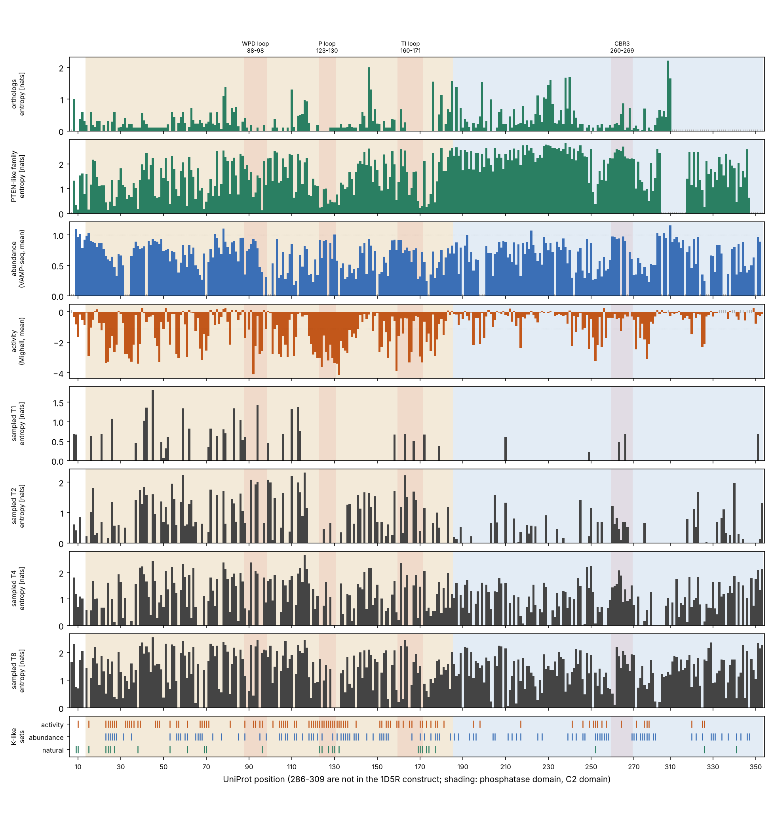
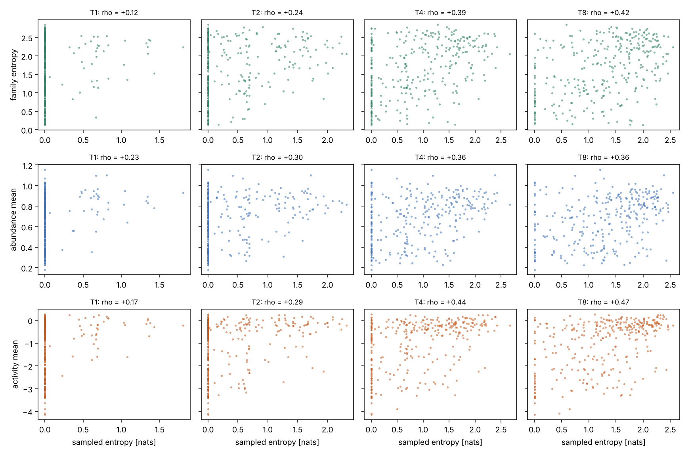
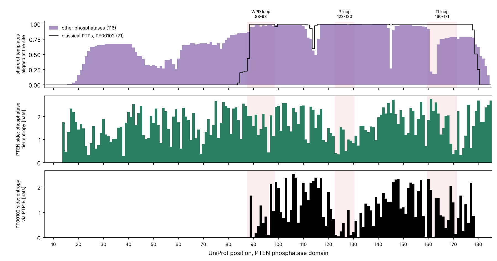

This is the long version of `pten_k_sites.md`. It explains what was compared, where every
number comes from, how to read each figure, and what to run on the GPU machine. Script:
`softmax/monte_carlo/pten_k_sites.py`. Outputs: `softmax/monte_carlo/pten_natural/`.

# 1. The question

In Zambon et al. 2024 a **K-site** is a site that the sampler keeps completely conserved at
the lowest temperatures, and that stays strongly conserved everywhere below the structural
transition. For protein G there are seven. The paper then asks whether those sites are also
the ones that nature keeps conserved in the homologs of the protein. If they are, the
effective energy has captured something real about what the fold needs.

For PTEN we can ask the same question three times, because there are three independent ways
of knowing that a site "cannot change":

| reference | the question it answers | where it comes from |
| --- | --- | --- |
| natural | which sites does evolution keep fixed? | an alignment of natural homologs |
| abundance | which sites, when mutated, make the protein disappear from the cell? | VAMP-seq, Matreyek et al. 2018 |
| activity | which sites, when mutated, stop the enzyme from working? | Mighell et al. 2018 |

Each reference gives one number per site. The sampler gives one number per site too, the
entropy of the residue at that site along a chain. Everything in this document is a
comparison between those per-site profiles.

**The numbering.** The sampled reference `pten_1d5r` is the crystal construct, 324 residues:
UniProt residues 7 to 285 followed by 310 to 353. The loop 286 to 309 was deleted to get
crystals. Two of the 324 residues are not native: the first one (a Met where the protein has
Glu7) and the one at the deletion junction (a Val). They have no experimental score and are
left out of every comparison. In the tables `site` is the 0-based index used in `data.dat`,
and `uniprot_pos` is the numbering both papers use. The phosphatase domain is UniProt 14 to
185 (172 sites) and the C2 domain is 186 to 351 (144 sites).

# 2. The two papers

## 2.1 Matreyek et al. 2018: abundance (VAMP-seq)

*Multiplex assessment of protein variant abundance by massively parallel sequencing.*
Nature Genetics 50, 874-882 (2018). PubMed 29785012.

**The idea.** A missense mutation can break a protein in two different ways. It can leave the
protein folded but remove a residue the chemistry needs, or it can make the protein unable to
fold. An unfolded protein is recognised by the cell's quality control and degraded, so its
steady-state amount drops. Measuring how much of each variant is present in the cell is
therefore close to measuring whether it folds.

**The method.** VAMP-seq stands for variant abundance by massively parallel sequencing.

1. A library of PTEN variants is built in which each variant is fused to green fluorescent
   protein (GFP). If the PTEN part is degraded, the GFP goes with it, so the cell's green
   fluorescence reports the abundance of that variant.
2. The library is put into human cells (HEK 293T) so that every cell carries exactly one
   variant, integrated at the same genomic position. A red protein (mCherry) is expressed
   from the same construct as an internal control, so the read-out is the green to red ratio.
3. The cells are sorted by that ratio into four bins, from dim to bright.
4. The variants in each bin are identified by sequencing. A variant found mostly in the dim
   bins has low abundance; one found mostly in the bright bins has normal abundance.
5. The result is an **abundance score** per variant, scaled so that wild type is 1 and the
   median nonsense (truncated) variant is 0.

**What they measured.** 7,801 single amino acid variants across two proteins, PTEN and TPMT.
For PTEN, in the data files of the paper: 4,112 of the 7,639 possible missense variants have
a score (54%), from up to eight replicate experiments. The synonymous variants have a median
of 1.00 and the nonsense variants a median of 0.06, which is the check that the scale means
what it says.

**How a variant is classified.** The reference distribution is the synonymous variants,
which do not change the protein. Its 5th percentile is 0.71. A variant is "low" when its
score and the upper end of its confidence interval are both below that value, "possibly low"
when only the score is, and "wt-like" or "possibly wt-like" on the other side. Of the 4,112
scored PTEN missense variants: 1,138 low, 633 possibly low, 879 possibly wt-like, 1,462
wt-like. The 1,138 is the number quoted in the abstract.

**What they found.**

- About a quarter of the scored missense variants clearly reduce abundance. They concentrate
  at buried, hydrophobic positions and at residues whose side chains make hydrogen bonds or
  salt bridges inside the protein.
- A set of positions has mean abundance *above* wild type. They lie near the face of the
  protein that binds the membrane.
- Low-abundance PTEN variants are enriched among the variants seen in cancer and in PTEN
  hamartoma tumour syndrome, so loss of abundance is a common way for PTEN to fail.
- Not every pathogenic variant has low abundance. Active-site variants are present at normal
  levels and are simply inactive. One of them, p.Pro38Ser, common in melanoma, is stable and
  acts as a dominant negative.
- The method works on other proteins as well.

**What we use.** Two files from the paper's repository (`github.com/FowlerLab/VAMPseq`):
`PTEN_variant_data.tsv`, one row per variant, and `PTEN_positional_data.tsv`, one row per
position, which carries the authors' own call of 115 positions as mutationally "intolerant"
and 41 as "enhanced". In that table the intolerant positions have a mean score between 0.13
and 0.72. We also use the 2021 follow-up (Matreyek et al., Genome Medicine 13:165), which
filled in missing variants and brings PTEN to 5,083 scored missense variants. The scores are
the copyright of the University of Washington, free for academic non-commercial use, which is
why the raw files are downloaded by the script and not stored in the repository.

## 2.2 Mighell et al. 2018: lipid phosphatase activity

*A saturation mutagenesis approach to understanding PTEN lipid phosphatase activity and
genotype-phenotype relationships.* American Journal of Human Genetics 102, 943-955 (2018).
PMC5986715.

**The idea.** Measure, for every possible single substitution, whether PTEN can still do its
job: remove the 3-phosphate from the membrane lipid PIP3.

**The method.** The assay runs in yeast, which has no PIP3 signalling of its own.

1. The human PI3 kinase catalytic subunit (p110-alpha, anchored to the membrane) is expressed
   in yeast. It converts the yeast's essential PIP2 into PIP3. The loss of PIP2 is toxic and
   the yeast stops growing.
2. PTEN is expressed in the same cell. A working PTEN converts PIP3 back to PIP2 and growth
   returns. Wild-type PTEN rescues growth; the catalytically dead C124S does not; partially
   active variants give intermediate growth.
3. A library holding every amino acid substitution at every codon, plus a stop codon and a
   single-codon deletion, is grown as a pool. Variants that rescue growth become more
   frequent, variants that do not become rarer.
4. Sequencing before and after selection gives a **fitness score** per variant: the
   log-scaled enrichment relative to wild type. Wild type is 0. Nonsense variants have a
   median of -3.7 in the data file.
5. Two independent yeast populations, three selection replicates each. The two populations
   agree with a Pearson correlation of 0.76.

**What they measured.** Scores for 8,019 variants, 95% of those intended. 7,244 of them pass
the high-confidence filter (86%). That count includes stops and deletions; the
high-confidence *missense* variants, which are the ones we use, are 6,564.

**How a variant is classified.** Again against the synonymous variants. In the paper a
variant is wild-type-like when it falls inside the range of the synonymous variants (about
-1 and above) and truncation-like when it falls inside the range of the nonsense variants
(about -2.15 and below). Anything in between is a partial loss of function, a hypomorph.
Among the high-confidence variants 67% are wild-type-like, 31% are damaging and 1% are
better than wild type; 1,243 missense variants are truncation-like. The 2021 abundance paper
uses a single cut at -1.11 for "loss of activity", and that is the value our script uses.

**What they found.**

- The phosphatase domain is far less tolerant than the C2 domain. The catalytic pocket is
  the least tolerant region: C124 and R130 accept no substitution, H93, K125 and K128 very
  few, D92 only asparagine, G129 only alanine and serine.
- Positively charged residues that bind the membrane matter: the PIP2-binding motif at
  residues 6 to 15, and R47.
- Truncations are damaging anywhere in the two domains and tolerated in the C-terminal tail.
- Fitness correlates with evolutionary conservation (Spearman 0.58) and with burial: the
  intolerant positions are 91% buried, the tolerant ones 26%.
- About half of PTEN's positions tolerate most substitutions.
- Clinically, the scores separate known pathogenic variants from benign ones better than the
  computational predictors they tested. Variants found in autism and developmental delay are
  on average milder than those found in PTEN hamartoma tumour syndrome: 41% against 20% fall
  in the hypomorphic range.

**What the assay does not see.** Protein-protein interactions, localisation, regulation by
phosphorylation and dominant-negative effects in human cells. It does partly see stability,
because an unstable variant is also inactive.

**What we use.** The supplementary table of the paper as redistributed in
`github.com/MatreyekLab/PTEN_composite` (`Mighell_PTEN_phosphatase_data.csv`), columns
`Cum_score` and `High_conf`.

## 2.3 Why two scans and not one

Abundance and activity overlap but are not the same thing. A variant that does not fold has
low abundance and low activity. A variant that folds but lacks a catalytic residue has normal
abundance and low activity. The sampler's energy `U_am` is built from ESM3's attention map
and knows about structure only, so in principle it should agree with abundance. Activity is
the control: sites that matter for activity but not for abundance are sites the sampler has
no reason to protect.

# 3. The natural reference

## 3.1 Where the alignment comes from

The file is the UniRef90 alignment of the 1D5R chain from OpenProteinSet (the alignments
computed for training OpenFold, public on Amazon S3, licence CC BY 4.0). It was made with
jackhmmer, a program that searches a sequence database for relatives of a query, builds a
statistical profile from the hits and searches again with the profile. UniRef90 is UniProt
clustered so that no two entries are more than 90% identical. The query is exactly our
324-residue reference, so the alignment columns are our sites and nothing has to be
re-aligned. It holds 7,989 hits.

Most hits are not PTEN. The PTEN-like family includes TPTE and the voltage-sensing
phosphatases, the tensins, and auxilin and GAK. All of them share the phosphatase domain and
the C2 domain, in that order. Further out are proteins that only share the phosphatase
domain.

## 3.2 The four tiers

The same alignment is cut at four depths. "Identity" is the fraction of aligned residues
equal to PTEN's. "Coverage" is the fraction of the 324 reference columns the hit covers.

| tier | rule | sequences | N_eff | median identity to PTEN | sites with an entropy |
| --- | --- | --- | --- | --- | --- |
| vertebrate | identity >= 0.90, coverage >= 0.8 | 92 | 22 | 0.96 | 280 |
| orthologs | identity >= 0.70, coverage >= 0.8 | 123 | 44 | 0.94 | 280 |
| family | coverage >= 0.8 (both domains present) | 2,716 | 506 | 0.33 | 305 |
| pdomain | covers >= 0.7 of the phosphatase domain | 6,002 | 1,125 | 0.34 | 172 |

**N_eff, the effective number of sequences.** Databases over-represent some groups (many
mammals, few of anything else). To stop a crowd of near-identical sequences from dominating,
each sequence is given the weight 1 / (number of sequences at least X% identical to it,
itself included). N_eff is the sum of the weights. X is 80% for the family and pdomain
tiers, the usual choice in the coevolution literature, and 95% for the two ortholog tiers,
because at 80% nearly all orthologs would fall in one cluster and N_eff would be about 1.

**Entropy.** For each site, the Shannon entropy of the weighted amino acid frequencies, in
nats: 0 when one residue is always there, ln 20 = 3.0 when all twenty are equally likely.

**Sites without an entropy.** A site gets no value when more than half of the weighted
sequences have a gap there. This happens at the C-terminal end. Natural PTEN has the 286 to
309 loop that the construct lacks, so many alignments stop at the deletion and never reach
310 to 353.

The thresholds are options of the script; section 7 shows how to change or remove them.

## 3.3 The flatness table, with the amount of data behind each row

| profile | data behind it | sites | mean | median | 10th to 90th percentile |
| --- | --- | --- | --- | --- | --- |
| vertebrate entropy [nats] | 92 sequences, N_eff 22 | 280 | 0.17 | 0.01 | 0.00 to 0.55 |
| orthologs entropy [nats] | 123 sequences, N_eff 44 | 280 | 0.31 | 0.19 | 0.00 to 0.73 |
| family entropy [nats] | 2,716 sequences, N_eff 506 | 305 | 1.66 | 1.76 | 0.56 to 2.57 |
| pdomain entropy [nats] | 6,002 sequences, N_eff 1,125 | 172 | 1.64 | 1.63 | 0.72 to 2.46 |
| abundance 2018, mean score | 3,349 variants on these sites | 256 | 0.68 | 0.71 | 0.34 to 0.95 |
| abundance 2018+2021, mean score | 4,079 variants on these sites | 289 | 0.67 | 0.71 | 0.34 to 0.94 |
| activity, mean score | 5,324 variants on these sites | 311 | -1.01 | -0.48 | -2.79 to 0.02 |

The variant counts are lower than the totals in section 2 because they count only the 322
native sites of the construct, not all 403 residues of PTEN. A site needs at least 5 scored
variants to get a mean; the median site has 14 for abundance and 18 for activity.

**Reading.** The vertebrate profile is flat: 176 of 280 sites are below 0.05 nats. The
ortholog profile is nearly flat. So an ortholog alignment cannot tell sites apart, as you
expected. But note how little data that conclusion rests on: 92 sequences worth 22
independent ones. A site with entropy 0 there may simply not have had time to change.
The family tier, the abundance scan and the activity scan are not flat at all, and they are
the three profiles the sampler is compared with.

# 4. The three K-like sets

For a set comparison each reference is turned into a list of sites.

| set | rule | sites | in the phosphatase domain | in the C2 domain |
| --- | --- | --- | --- | --- |
| natural | family entropy below 0.5 nats | 28 | 23 | 3 |
| abundance | the authors' "intolerant" positions | 108 | 61 | 47 |
| activity | at least half of the scored variants below -1.11 | 97 | 77 | 19 |

The natural set contains the catalytic residues H123, C124, G127, G129, R130 and G132, then
D24, P38 and P96, the TI loop (P169, S170, Q171, R173, Y174, Y177) and D252 in the C2 domain.

**Overlaps.** With 324 sites, two unrelated sets of sizes a and b share a x b / 324 sites on
average. P is the probability of an overlap at least as large as the observed one if the two
sets were unrelated (hypergeometric test).

| pair | observed | expected by chance | P |
| --- | --- | --- | --- |
| natural and activity | 24 | 8.4 | 2e-10 |
| abundance and activity | 56 | 32.3 | 2e-9 |
| natural and abundance | 12 | 9.3 | 0.18 |

Eleven sites are in all three sets: L23, D24, L25, Y27, V53, H61, C124, G129, S170, Y177, D252.

**Reading.** What the family conserves is what the enzyme needs for catalysis, and it is
almost unrelated to what the fold needs. The clearest examples are R15, H123 and R130: they
are among the most conserved residues in the family, and their mean abundance is 0.92 to
1.03, meaning the protein is perfectly stable without them. This is the main reason to judge
the sampler against abundance first.

# 5. The sampler against the references

## 5.1 How the sampled entropy is computed

A chain is a sequence that changes one residue at a time. `data.dat` records every proposed
move and whether it was accepted, and `start.txt` the starting sequence. Replaying the
accepted moves reconstructs the sequence at every step. For each site the script counts how
many steps it spent on each amino acid, over the second half of the chain (the first half is
discarded as burn-in), and takes the Shannon entropy of those frequencies. A site that never
changed has entropy 0. The reconstruction is checked: the Hamming distance to the reference
at the end matches the `Hd_to_ref` column of `data.dat`.

Two other per-site quantities come out of the same replay:

- `native_frac`, the share of the time the site holds the reference residue;
- `mean_dU`, the average energy change of the moves *proposed* at the site, accepted or
  not. It is the sampler's own estimate of what mutating that site costs, and it needs no
  equilibration.

## 5.2 The numbers

Chains started from the reference, 220,000 moves at T = 1, 2, 4, 8 (run of 2026-11-13).
Spearman rank correlation between the sampled entropy and each reference: +1 means the two
rank the sites identically, 0 means no relation. With about 300 sites, values beyond 0.12
are outside chance at the 5% level. All references are oriented so that higher means more
tolerant, so a positive correlation is agreement.

| T | sites at entropy 0 | family | abundance | activity | family, burial removed | abundance, burial removed | activity, burial removed |
| --- | --- | --- | --- | --- | --- | --- | --- |
| 1 | 220 | +0.15 | +0.19 | +0.19 | +0.01 | +0.11 | +0.07 |
| 2 | 100 | +0.37 | +0.31 | +0.38 | +0.15 | +0.09 | +0.19 |
| 4 | 25 | +0.52 | +0.41 | +0.53 | +0.31 | +0.15 | +0.32 |
| 8 | 9 | +0.61 | +0.46 | +0.61 | +0.45 | +0.19 | +0.41 |

Mean sampled entropy inside each K-like set divided by the mean outside it:

| T | natural | abundance | activity |
| --- | --- | --- | --- |
| 1 | 0.23 | 0.34 | 0.46 |
| 2 | 0.29 | 0.45 | 0.39 |
| 4 | 0.41 | 0.63 | 0.53 |
| 8 | 0.51 | 0.76 | 0.64 |

A ratio of 1 would be the flat case: the sampler varying those sites as much as any other.
Every ratio is well below 1.

**The significance test.** Neighbouring sites resemble each other (a buried strand, an
exposed loop), so shuffling sites at random would exaggerate the significance. Instead the
whole set is shifted along the sequence by 1, 2, ..., 323 positions, which keeps its pattern
of runs, and the observed difference is ranked among the 323 shifted ones. The smallest p
this can give is 1/324 = 0.003, and that is the value reached at T >= 2 for almost every set.

**The sampler's own K-sites.** With the strict definition (entropy below 0.05 at both T = 1
and T = 2) there are 104. They contain 16 of the 28 natural sites (9.0 expected), 43 of the
108 abundance sites (34.7 expected) and 46 of the 97 activity sites (31.1 expected).

## 5.3 The burial control

A residue buried in the core is hard to mutate for any reason, and all the references know
it: relative solvent accessibility (RSA, the exposed fraction of the side chain in the
crystal, from the VAMP-seq table) correlates +0.65 with abundance, +0.64 with activity and
+0.53 with family entropy. It also correlates +0.54 to +0.58 with the sampled entropy at
T = 4 and 8. So part of any agreement is just "both know which sites are buried".

The columns "burial removed" are partial correlations: RSA is regressed out of both ranks
and the residuals are correlated. What remains is agreement that burial cannot explain. At
T = 8 it is +0.45 for the family entropy, +0.41 for activity and +0.19 for abundance.

**Reading.** The sampler is not flat, and the signal grows with longer chains. But once
burial is set aside it follows what the family conserves more than what keeps the protein
abundant. That is unexpected, because the energy contains no catalysis. Two explanations
are worth discussing with the supervisors. ESM3 was trained on natural sequences, so its
attention map may encode family conservation directly, function included. Or the active
site of PTEN is unusually well packed and RSA does not capture that. The single-mutant scan
of `U_am` (section 9) would help to separate them.

## 5.4 The figures

**Figure 1, `pten_site_profile_sampled.png`: everything along the sequence.**

The horizontal axis is the sequence, labelled in UniProt numbering; one bar per site. The
beige background is the phosphatase domain, the blue one the C2 domain. The four pink bands
are landmarks: the WPD loop (88 to 98), the P loop that holds the catalytic cysteine (123 to
130), the TI loop (160 to 171) and the CBR3 loop of the C2 domain that touches the membrane
(260 to 269).

- Rows 1 and 2, green: natural entropy, orthologs and family. Tall bar = variable site.
  A grey tick on the baseline means no value at that site.
- Row 3, blue: mean abundance score. The dotted line at 1 is wild type. A short bar is a
  site where mutations make the protein disappear.
- Row 4, orange: mean activity score, plotted downwards from 0. The dotted line is -1.11.
  A long bar is a site where mutations kill the enzyme.
- The grey rows: sampled entropy, one row per chain.
- Bottom row: the three K-like sets as tick marks.

What to look for: the P loop is a trough in the family entropy and a deep spike in activity,
yet abundance there is close to 1. In the sampled rows, the troughs line up with the regions
where the references are low, and they fill in as T rises.

**Figure 2, `sampled_vs_references.png`: site by site.**

Each dot is one site. Horizontal: its sampled entropy. Vertical: the reference (family
entropy, abundance, activity, from top to bottom). One column per chain, with the Spearman
correlation in the title. A cloud rising to the right is agreement. The vertical stripe of
dots at 0 on the left is the set of sites the chain never changed, which is why cold chains
look weak. The new version of the script writes one file per reference with a panel for
every chain: `sampled_vs_family.png`, `sampled_vs_abundance.png`, `sampled_vs_activity.png`.

**Figure 3, `sampled_vs_references_by_T.png` (new, produced by your run).** The Spearman
correlations of section 5.2 against temperature, for the chains started from the reference.
Solid lines are the raw correlations, dashed lines the ones with burial removed, one colour
per reference. Dots are single chains, lines the mean of the chains at that temperature.

**Figure 4, `pten_ptp_superfamily.png`: how far other phosphatases align.**

Only the phosphatase domain is shown. Top panel: for each PTEN site, the share of other
phosphatase structures whose profile alignment reaches it. The black line is the classical
protein tyrosine phosphatases (Pfam PF00102), the purple area all other related
phosphatases. The black line is zero until residue 85: classical PTPs align only to the
second half of the domain. Middle panel: PTEN's own conservation (the pdomain tier). Bottom
panel: the conservation of the classical PTP family, carried onto the PTEN sites it reaches.
The two agree at the P loop and little elsewhere.

# 6. InterPro, Pfam, and the step to run locally

## 6.1 What they are

**Pfam** is a catalogue of protein families. Each family (for example PF00102, the classical
protein tyrosine phosphatase domain) is defined by a hand-curated *seed* alignment of
representative sequences. From the seed a profile hidden Markov model (HMM) is built, which
is a statistical description of the family: for each column, which amino acids are likely,
and where insertions and deletions tend to occur. The HMM is then run against the sequence
databases, and everything that matches forms the *full* alignment. A family has an accession
(PF followed by five digits) and belongs to a *clan* when several families share a common
ancestor.

**InterPro** is the database at the European Bioinformatics Institute (EBI) that brings
together Pfam and a dozen similar resources. Since 2023 Pfam no longer has its own website
and is served through InterPro. For our purposes InterPro is where you look up which Pfam
families lie on a protein and download their alignments, either in the browser
(`www.ebi.ac.uk/interpro`) or through its programming interface, which is what the script
uses.

**Why it matters here.** Our natural reference is a jackhmmer search started from PTEN. A
Pfam alignment is the community's curated version of the same thing, built from many
members and not from one query, and it is the reference Zambon's paper used for protein G.
It is the natural cross-check of section 3.

**Which families.** PTEN does not belong to PF00102. That family is the classical PTP
domain of about 240 residues; in the structure comparisons it aligns only to UniProt 89 to
179 of PTEN, 53% of the phosphatase domain. PTEN's C2 domain is PF10409. For the
phosphatase domain I do not want to state the accession from memory, so the script asks
InterPro which Pfam families it places on human PTEN (UniProt P60484) and uses those.

## 6.2 What the new `pfam` step does

1. Asks InterPro for the Pfam families on P60484 and prints them with their residue ranges.
2. Downloads the alignment of each (the full one by default) into `pten_natural/raw/`.
3. Finds the row that is human PTEN. That row says which alignment column corresponds to
   which PTEN residue, and through the numbering of section 1 to which of our sites.
4. Keeps the rows that cover at least 70% of PTEN's columns, weights them at 80% identity,
   and computes the entropy per site, exactly as for the tiers.
5. Prints, per family: number of rows, N_eff, median identity to PTEN, sites covered, the
   Spearman correlation with the family tier, the pdomain tier, the orthologs, abundance and
   activity, the overlap of its conserved sites with the three K-like sets, and the list of
   conserved sites.
6. Writes `pten_site_table_pfam.csv`, `pfam_summary.tsv` and `pten_pfam_profile.png`, a
   figure with the jackhmmer tiers, one row per Pfam family, abundance and activity.

If human PTEN is not a row of an alignment (possible for a seed alignment, and certain for
PF00102), the script places PTEN on the family's HMM with `hmmalign`, a program of the HMMER
package, and says so in the output. A result obtained that way for a family PTEN does not
belong to should be read with care.

## 6.3 Commands

    cd softmax/monte_carlo
    python pten_k_sites.py fetch                  # if pten_natural/raw is not there yet
    nohup python -u pten_k_sites.py pfam > pten_natural/pfam.log 2>&1 &

Variants:

    python pten_k_sites.py pfam --alignment seed          # the small curated alignment
    python pten_k_sites.py pfam --accessions PF10409      # one family, chosen by hand
    python pten_k_sites.py pfam --accessions PF00102      # needs hmmalign (PTEN is not a member)
    python pten_k_sites.py pfam --sto PF10409=/path/to/file.sto   # a file saved from the website

`hmmalign` is needed only for the PF00102 case or if PTEN is missing from an alignment:
`conda install -c bioconda hmmer`.

**This step has not been run.** The cloud machine cannot reach `www.ebi.ac.uk`. I tested the
parsing, the projection and the figure on a made-up alignment file, but the two web
addresses are written from the InterPro documentation as I remember it and have not been
exercised. If a download fails the script prints the address it tried. In that case open the
entry's page on the InterPro website, download the alignment from its Alignment tab, and
pass the file with `--sto`.

# 7. Changing or removing the thresholds

Three options decide which sequences enter the natural tiers. Each takes a fraction (0.9), a
percentage (90) or the word `none`.

| option | default | effect |
| --- | --- | --- |
| `--vertebrate-identity` | 0.9 | minimum identity to PTEN for the vertebrate tier |
| `--ortholog-identity` | 0.7 | minimum identity to PTEN for the orthologs tier |
| `--min-coverage` | 0.8 | minimum share of the 324 columns covered, for the vertebrate, orthologs and family tiers |
| `--pdomain-coverage` | 0.7 | minimum share of the phosphatase columns covered, for the pdomain tier |

They work with `build`, `compare`, `family` and `pfam`, and the chosen values are written
in `natural_tiers.tsv` (columns `min_identity`, `min_coverage`).

    python pten_k_sites.py build --vertebrate-identity 0.95
    python pten_k_sites.py build --vertebrate-identity none
    python pten_k_sites.py build --vertebrate-identity none --min-coverage none

What they do, measured on the alignment in hand:

| setting | vertebrate tier becomes | sequences | N_eff | mean entropy |
| --- | --- | --- | --- | --- |
| default (0.9) | close orthologs | 92 | 22 | 0.17 |
| `--vertebrate-identity 0.95` | closer still | 61 | 6 | 0.07 |
| `--vertebrate-identity none` | identical to the family tier | 2,716 | 506 | 1.66 |
| `--vertebrate-identity none --min-coverage none` | every hit, fragments included | 7,990 | 1,325 | 1.83 |

Two things to know. With no identity threshold the tier stops being about orthologs: it is
the whole family, and the script then weights it at 80% like the family. With no coverage
threshold fragments are counted, the gap fraction rises at the ends, and fewer sites get an
entropy (255 against 305). Dropping only the coverage threshold while keeping identity at
0.7 is a reasonable middle setting: it raises the orthologs from 123 sequences to 545.

To write the results of a trial somewhere else and keep the default outputs, add
`--out-dir pten_natural/trial_name`.

# 8. What to run, and what comes out

Nothing below needs the GPU. The comparison takes a few minutes, mostly replaying the long
chains.

    cd softmax/monte_carlo
    git pull

    # 1. raw data (20 MB, once)
    python pten_k_sites.py fetch

    # 2. the three references and the K-like sets
    python pten_k_sites.py build > pten_natural/build.log 2>&1

    # 3. every chain of the ladder against the references
    nohup python -u pten_k_sites.py compare --runs-dir pten1d5r_study/equil \
        --cold T1 T2 > pten_natural/compare.log 2>&1 &

    # 4. the superfamily check from structure alignments
    python pten_k_sites.py family > pten_natural/family.log 2>&1

    # 5. the Pfam version (needs internet)
    nohup python -u pten_k_sites.py pfam > pten_natural/pfam.log 2>&1 &

**Step 3 compares everything.** `--runs-dir` takes every `T*/chain*` directory under
`pten1d5r_study/equil`. Chain 0 of a temperature is labelled `T4`, the others `T4.c1`. The
log says for each chain whether it started from the reference. The chains started from a
random sequence are included, but at low temperature they are trapped far from PTEN and
their entropy says nothing about PTEN's sites; add `--reference-only` to leave them out.
`--cold T1 T2` names the chains whose entropy defines the sampler's strict K-sites. You can
still pick chains by hand with `--runs T1=dir T2=dir`, and limit the profile figure to some
labels with `--show`.

**Output files**, all in `pten_natural/`:

| file | content |
| --- | --- |
| `pten_site_table.csv` | one row per site: numbering, domain, the four natural entropies, both scans, RSA, the three K-like sets |
| `natural_tiers.tsv` | the tiers: thresholds, sequences, N_eff, median identity |
| `flatness.tsv` | the table of section 3.3 |
| `pten_site_profile.png` | Figure 1 without the sampled rows |
| `pten_site_table_sampled.csv` | the site table plus, per chain, entropy, native_frac, proposals, accepted, mean_dU |
| `sampled_vs_references_spearman.tsv` | correlations of section 5.2, for the entropy and for -mean_dU |
| `sampled_vs_references_partial_rsa.tsv` | the same with burial removed |
| `sampled_entropy_in_K_sets.tsv` | inside/outside ratios and shift-test p values |
| `pten_site_profile_sampled.png` | Figure 1 |
| `sampled_vs_family.png`, `sampled_vs_abundance.png`, `sampled_vs_activity.png` | Figure 2, one file per reference |
| `sampled_vs_references_by_T.png` | Figure 3 |
| `pten_site_table_family.csv`, `pten_ptp_superfamily.png` | the structure-alignment check and Figure 4 |
| `pten_site_table_pfam.csv`, `pfam_summary.tsv`, `pten_pfam_profile.png` | the Pfam step |
| `*.log` | the printed tables of each step |

The `.png` files are ignored by git under `monte_carlo/`. To keep one in the repository copy
it to `softmax/docs/figures/` and add it with `git add -f`.

# 9. Cautions, and what is not verified

1. **The chains are not equilibrated.** At T = 1, 198 sites never accepted a move in
   220,000. The list of the sampler's K-sites will keep shrinking as chains get longer. The
   correlations at T = 4 and 8 are the ones to quote.
2. **One chain's time average underestimates the entropy of the ensemble.** Compare ratios
   and ranks, not absolute entropies.
3. **About half of the agreement is burial**, and the remainder favours family conservation
   over abundance (section 5.3).
4. **The orthologs are few.** 92 sequences, N_eff 22. "Flat" for that tier partly means
   "little data".
5. **The natural thresholds are choices.** 0.5 nats for the natural K-like set, half the
   variants for the activity set, 5 variants for a site mean. They are options of the script
   (`--natural-k`, `--activity-k`) or constants at its top.
6. **Sources.** The Matreyek summary is checked against the PubMed abstract, the paper's
   data files and its analysis notebook. The Mighell summary is checked against the bioRxiv
   preprint of the paper and the data file, because the PMC page would not load from the
   cloud machine; numbers in the published version may differ slightly from the preprint.
   An earlier note said "7,244 high-confidence missense variants": 7,244 is all
   high-confidence variants, of which 6,564 are missense.
7. **The Pfam step is untested against the live InterPro service** (section 6.3).

**The next experiment**, still not written: compute `U_am` for all 324 x 19 single mutants
of the reference, about 6,200 forward passes on the GPU. It is the direct counterpart of the
two scans, needs no equilibration, and would show whether the energy itself, before any
sampling, sides with abundance or with family conservation.
